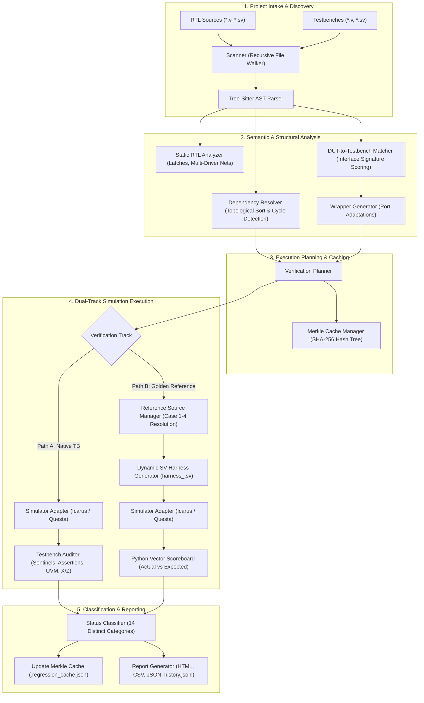
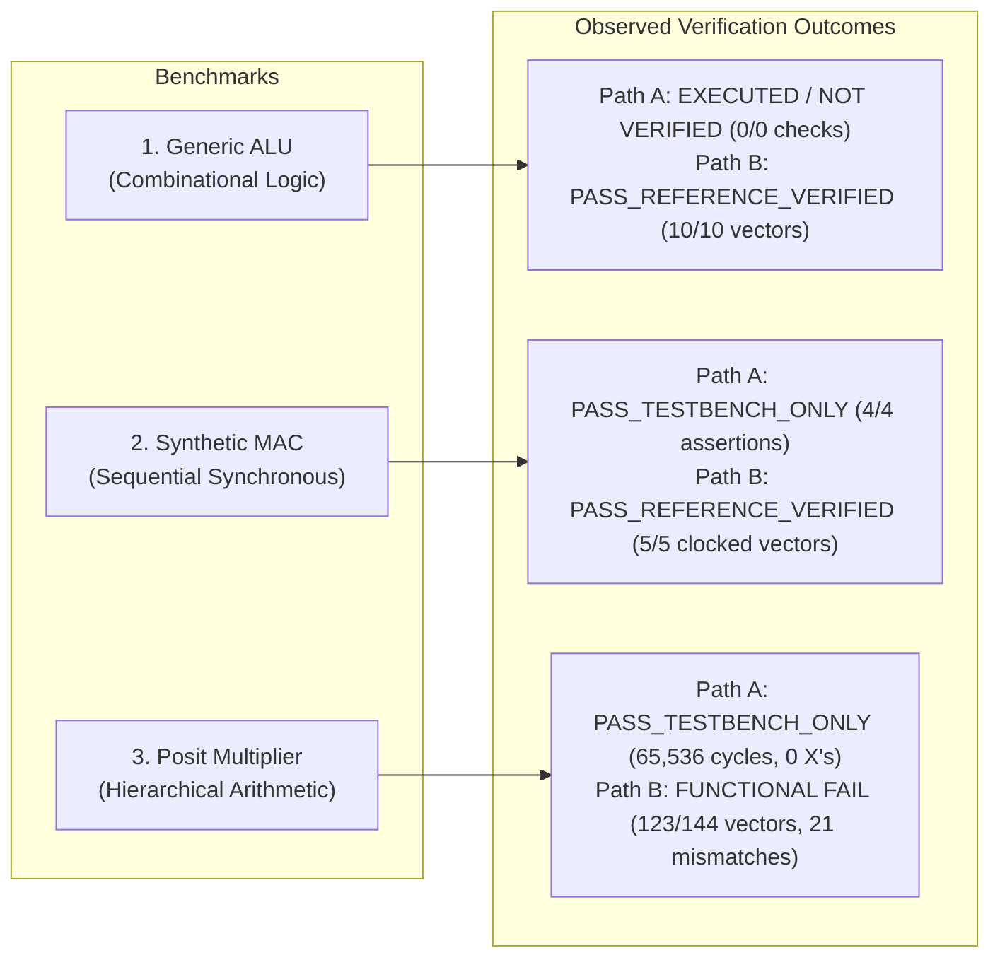

# Automated RTL Regression and Verification Framework

A modular, reproducible, project-independent RTL regression and verification framework for Verilog and SystemVerilog digital hardware designs.

[](https://www.python.org/downloads/)
[](#3-research-and-tool-evaluation)
[](#7-repository-structure)
[](#5-what-is-generic-and-reusable)

---

## Table of Contents
1. [Project Overview](#1-project-overview)
2. [Research Problem and Motivation](#2-research-problem-and-motivation)
3. [Research and Tool Evaluation](#3-research-and-tool-evaluation)
4. [Framework Architecture](#4-framework-architecture)
5. [What is Generic and Reusable?](#5-what-is-generic-and-reusable)
6. [What is Project-Specific?](#6-what-is-project-specific)
7. [Repository Structure](#7-repository-structure)
8. [Experimental Evaluation & Benchmark Results](#8-experimental-evaluation--benchmark-results)
9. [What Did the Research Demonstrate?](#9-what-did-the-research-demonstrate)
10. [Limitations and Future Work](#10-limitations-and-future-work)
11. [How to Reuse the Framework](#11-how-to-reuse-the-framework)
12. [Research Contribution Summary](#12-research-contribution-summary)

---

## 1. Project Overview

### What RTL Verification Problem is Being Addressed?
Modern digital design verification frequently relies on fragile, ad-hoc shell scripts tightly coupled to specific Device Under Test (DUT) interfaces and idiosyncratic testbench conventions. When researchers or engineers inherit unfamiliar Verilog/SystemVerilog designs, setting up regression testing requires tedious manual intervention: inspecting port lists, discovering hierarchical submodule dependencies, writing custom wrapper glue-logic, and hand-crafting simulation scripts.

Furthermore, traditional simulation flows suffer from **false-confidence failure modes**:
- A simulator exiting with return code 0 is routinely reported as a "PASS", even when the testbench contained zero functional assertions or merely verified that signals were not uninitialized (`x`/`z`).
- Self-checking testbenches often embody the exact same algorithmic misinterpretations as the hardware implementation under test.

### Why Automation is Useful
Automating the intake, dependency analysis, interface matching, simulation execution, log auditing, and independent reference comparison eliminates manual setup overhead. It ensures that regressions are deterministic, reproducible across different machine environments, and immune to stale caching.

### What the Proposed Framework Does
This project introduces an automated, non-invasive regression verification framework that:
1. Discovers and parses Verilog/SystemVerilog source files without requiring code modifications or inline pragmas.
2. Resolves hierarchical module dependencies and topological elaboration order.
3. Structurally matches DUTs to compatible testbenches.
4. Executes dual-track verification:
   - **Path A (Native Testbench Execution)**: Executes existing testbenches and audits simulation logs for assertions, UVM markers, and completion sentinels.
   - **Path B (Independent Reference Verification)**: Dynamically generates SystemVerilog harnesses that stimulate the DUT with external vectors and verify outputs against an independent software scoreboard.
5. Emits structured HTML dashboards, machine-readable CSV/JSON summaries, and historical run records.

### What Makes the Framework Reusable?
The reusable verification engine is completely decoupled into the **`framework/`** package (`rtl_framework`). It contains zero hardcoded assumptions about specific arithmetic domains (no ALU opcodes, no Posit arithmetic, no adder logic) and zero hardcoded port names or file paths. A researcher can download **only** `framework/`, install it via `pip install -e .`, and immediately verify their own Verilog projects.

---

## 2. Research Problem and Motivation

### The Manual Stages of RTL Verification
In standard exploratory and academic hardware development, verifying a digital design entails eight distinct manual stages:
1. **RTL Discovery**: Identifying which files contain synthesizable logic versus testbenches.
2. **DUT/Testbench Association**: Determining which testbench exercises which DUT based on compatible port counts, widths, and directions.
3. **Dependency Resolution**: Manually establishing the bottom-up compilation order of submodules and nested include headers (`header.vh`).
4. **Compilation**: Invoking EDA compilers (`iverilog`, `vlog`) with appropriate language flags and include search paths.
5. **Simulation Orchestration**: Running the simulation binary while monitoring for timeouts, hangs, or early termination.
6. **Result Checking**: Inspecting raw terminal transcripts for assertion statements or error strings.
7. **Independent Output Comparison**: Comparing simulated signal waveforms or memory dumps against golden mathematical models.
8. **Regression Reporting**: Aggregating multi-module pass/fail outcomes into human-readable summaries.

### The Research Objective
The central question investigated in this research is:
> **How can these eight stages of RTL verification be fully automated through an independently reusable software framework that operates on arbitrary, unfamiliar Verilog/SystemVerilog codebases without requiring source modifications, custom annotations, or intrusive test harnesses?**

To answer this question, this project investigated existing open-source and commercial EDA verification tools, identified their operational limitations for legacy and arbitrary codebases, and implemented a unified Python-based orchestration framework.

---

## 3. Research and Tool Evaluation

Thirteen verification tools, methodologies, and frameworks were investigated and evaluated against the project's non-invasive automation objective.

| Tool / Methodology | Category | Evaluated Role | Status in Current Project | Key Finding / Rationale |
|---|---|---|---|---|
| **Icarus Verilog 12.0** | Open-Source Simulator | Primary 4-state simulation engine | **IMPLEMENTED, TESTED & DEMONSTRATED** | Active default simulator. Full IEEE 1364/2005 support, event delays (`#`), file I/O (`$readmemh`), and zero-licensing overhead. |
| **Siemens Questa 2025.3** | Commercial Simulator | Commercial IEEE 1800 SystemVerilog engine | **IMPLEMENTED & TESTED** | Supported via `QuestaSimulatorAdapter`. Features single-session mutex serialization (`_license_lock`) to prevent concurrent license checkout errors under academic node-locked licenses (`SALT_LICENSE_SERVER`). *(Note: Direct execution inside restricted Windows sandboxes is blocked by system DLL relocation WinError 623; unsandboxed execution operates cleanly).* |
| **Tree-Sitter Verilog** | AST Grammar | Concrete syntax tree parser | **IMPLEMENTED, TESTED & DEMONSTRATED** | Robust, error-tolerant C-based AST parser. Accurately extracts ANSI/non-ANSI ports, parameters, module instantiations, and testbench markers without external tool dependencies. |
| **Edalize 0.6.8** | EDA Abstraction | Build manifest generator | **IMPLEMENTED & TESTED** | Evaluated for tool-agnostic toolchain invocation. Successfully generates standardized EDAM manifests (`edam.json`) via `EdalizeSimulatorAdapter`. Direct execution on Windows requires external GNU `make`. |
| **HDLRegression 1.7.1** | Regression Framework | Test discovery & dependency ordering | **METHODOLOGY REUSE** | Evaluated on Siemens Questa. **Fatal Limitation**: Strictly requires `//hdlregression:tb` inline source pragmas; discovers 0 testbenches on legacy RTL. Framework adopted its topological dependency principles while providing zero-annotation discovery. |
| **VUnit 4.7.1** | Unit Test Runner | Test execution & assertions | **INVESTIGATED (NOT INTEGRATED)** | Excellent for new designs, but strictly incompatible with legacy Verilog: explicitly rejects library `work` and requires testbenches to instantiate VUnit runner packages. |
| **Cocotb 2.1.0** | Co-simulation | Python VPI cosimulation driver | **INVESTIGATED (PATH B ADAPTER)** | Outstanding for driving DUTs from Python coroutines. Replaces legacy Verilog testbenches rather than executing them. |
| **Verilator 5.0+** | Cycle-Accurate Simulator | High-speed C++ simulation & linting | **IMPLEMENTED (ADAPTER INTERFACE)** | Extreme execution throughput, but 2-state only (converts `x`/`z` to 0/1) and does not support event-driven `#` delays common in legacy testbenches. |
| **Yosys 0.40+** | Synthesis & Formal | Static netlist inspection | **METHODOLOGY REUSE** | Reused AST netlist inspection concepts in `static_analyzer.py` to statically detect unintended latch inference, multi-driven nets, and port width discrepancies. |
| **UVM / PyUVM** | Verification Methodology | Assertion & reporting conventions | **METHODOLOGY REUSE** | Auditor natively recognizes standard UVM reporting macros (`UVM_INFO`, `UVM_WARNING`, `UVM_ERROR`, `UVM_FATAL`). |
| **MANTRA / MANTRA2** | Mutation Testing | Fault injection algorithms | **METHODOLOGY REUSE** | Implemented AST mutation engine (`mutator.py`) supporting 7 standard fault operators (AOR, BOR, OI, CS, COA, ROR, SOR) to evaluate testbench effectiveness. |

---

## 4. Framework Architecture

The framework coordinates verification across an automated multi-stage pipeline:



---

## 5. What is Generic and Reusable?

The independently extractable core resides in **`framework/`** (packaged as `rtl-framework`):

| Core Module | Generic Responsibilities |
|---|---|
| `scanner.py` | Recursively walks project directories to locate RTL sources, headers, and reference tables. |
| `parser.py` | Extracts module declarations, ANSI/non-ANSI port signatures, parameters, and child instantiations via Tree-Sitter AST analysis. |
| `dependency_resolver.py` | Computes topological module compilation order and detects circular dependency cycles. |
| `matcher.py` | Scores structural compatibility between DUTs and testbenches based on port directions, names, and widths; flags ambiguous matches. |
| `wrapper_generator.py` | Synthesizes non-invasive SystemVerilog wrapper modules when port naming or vector slice alignments differ between DUT and TB. |
| `planner.py` | Combines matched pairs, dependencies, and reference files into deterministic verification plans. |
| `executor.py` | Subprocess adapters for Icarus Verilog, Siemens Questa, and Edalize EDAM manifest generation. |
| `auditor.py` | Audits simulation transcripts for completion sentinels, self-checking assertions, UVM reports, and unknown (`x`/`z`) states. |
| `reference_verifier.py` | Synthesizes dynamic SystemVerilog test harnesses (`harness_<dut>.sv`) to drive external reference vectors and score outputs. |
| `reference_manager.py` | Manages primary and secondary reference sources, resolves priority cases (Case 1–4), and flags disputed or unavailable oracles. |
| `cache_manager.py` | Computes SHA-256 Merkle trees of sources, dependencies, includes, references, and compiler flags for instant replay. |
| `report_generator.py` | Generates interactive visual HTML dashboards, summary CSV files, JSON diagnostics, and historical JSONL records. |
| `static_analyzer.py` | AST-level linter checking for unintended latch inference in combinational blocks, multi-driven nets, and port width mismatches. |
| `mutator.py` | Injects MANTRA2 first-order hardware mutations (AOR, BOR, OI, CS, COA, ROR, SOR) into ASTs to evaluate testbench adequacy. |
| `provider.py` | Extensible plugin interface (`ReferenceProvider`) allowing users to register custom reference generators. |
| `cli.py` | Command-line interface orchestration (`rtl-framework run`, `replay`, `--version`). |

> **Testing Fixtures Note**: Generic framework tests in `framework/tests/` use small Verilog fixtures (`designs/`, `testbenches/`, `references/`) to validate that the parser, matcher, and executor work correctly. These fixtures are test assets, not runtime framework dependencies.

---

## 6. What is Project-Specific?

To prevent arithmetic or benchmark assumptions from contaminating the generic engine, all project-specific assets are quarantined outside `framework/`:

- **Demonstration Benchmarks (`examples/`)**:
  - `examples/generic_alu/`: Contains 8-bit combinational ALU RTL, testbench, and golden reference table.
  - `examples/synthetic_mac/`: Contains sequential clocked MAC RTL, testbench, and golden reference table.
  - `examples/posit_multiplier/`: Contains 16-bit approximate Posit multiplier RTL, testbench, and golden reference table.
- **Optional Extensions (`extensions/`)**:
  - `extensions/posit/`: Contains `posit_model.py`, a pure Python mathematical model of $\text{Posit}\langle 16, 2\rangle$ arithmetic and tapered regime decoders.
  - `extensions/adder/`: Contains `generate_lut.py`, a full-adder truth table generation script.
- **Development & Audit Utilities (`tools/`)**:
  - `tools/generic/`: Dual-path validators, cache testers, and extraction verifiers.
  - `tools/posit/`: Posit reference generation and mismatch auditing utilities.
  - `tools/simulator/`: Siemens Questa environment verifiers.

An external researcher does **not** need `extensions/`, `examples/`, or `tools/` to verify their own RTL designs.

---

## 7. Repository Structure

```text
RTL-Regression-and-Verification-Framework/
│
├── framework/                         # THE REUSABLE PRODUCT (100% Extractable)
│   ├── src/
│   │   └── rtl_framework/            # Core Python package (16 generic modules)
│   ├── tests/                         # Framework test suite (99 tests across unit/integration/regression)
│   │   ├── unit/                      # 10 unit test suites
│   │   ├── integration/               # 9 integration test suites
│   │   ├── regression/                # 2 regression test suites
│   │   └── fixtures/                  # Framework test fixtures (designs, testbenches, references)
│   ├── pyproject.toml                 # Standard Python packaging specification (PEP 517/518)
│   ├── requirements.txt               # Direct runtime dependencies
│   └── README.md                      # Standalone framework documentation
│
├── examples/                          # Standalone Demonstration Benchmarks
│   ├── generic_alu/                   # Combinational 8-bit ALU benchmark
│   ├── synthetic_mac/                 # Sequential synchronous MAC benchmark
│   └── posit_multiplier/             # Approximate Posit<16,2> multiplier benchmark
│
├── extensions/                        # Optional Project-Specific Providers
│   ├── adder/                         # Full-adder truth table generator
│   └── posit/                         # Posit<16,2> arithmetic model & auditor
│
├── tools/                             # Development & Audit Utilities
│   ├── generic/                       # Path validators, cache checkers, extraction tests
│   ├── posit/                         # Posit reference generator & mismatch auditors
│   └── simulator/                     # Siemens Questa environment checks
│
├── docs/                              # Research Documentation
│   ├── architecture/                  # System design specifications
│   ├── usage/                         # Usage guides & demonstration scripts
│   ├── research/                      # Academic reports & tool evaluations
│   └── validation/                    # Baseline test logs & validation evidence
│
├── reports/final/                     # Preserved Validation Logs & Cryptographic Manifests
├── run_demo.ps1                       # One-command demonstration runner
├── README.md                          # Repository root documentation (this file)
└── .gitignore                         # Git exclusion rules
```

---

## 8. Experimental Evaluation & Benchmark Results

The framework was evaluated across three representative benchmark architectures selected to test distinct verification challenges:



### Empirical Execution Results

| Benchmark | Architecture | Characteristics | Path A Result | Path B Result | Key Finding |
|---|---|---|---|---|---|
| **Generic ALU** (`examples/generic_alu/`) | Combinational | 8-bit ALU with opcode-decoded arithmetic and bitwise logic | `EXECUTED / NOT VERIFIED` (0/0 assertions) | `PASS_REFERENCE_VERIFIED` (10/10 vectors matched) | Demonstrates that returncode 0 without checks is not a PASS; Path B independent reference successfully verifies functional correctness. |
| **Synthetic MAC** (`examples/synthetic_mac/`) | Sequential | Synchronous MAC with clock (`clk`), active-low reset (`rst_n`), enable (`en`), and overflow flag | `PASS_TESTBENCH_ONLY` (4/4 assertions passed) | `PASS_REFERENCE_VERIFIED` (5/5 clocked vectors matched) | Demonstrates automated sequential SystemVerilog harness generation driving clock, reset duration, and pipeline latency. |
| **Posit Multiplier** (`examples/posit_multiplier/`) | Hierarchical Arithmetic | 16-bit approximate Posit multiplier ($\text{Posit}\langle 16, 2\rangle$) via T-LEAP architecture (21 Verilog modules) | `PASS_TESTBENCH_ONLY` (65,536 cycles completed) | `FUNCTIONAL FAIL` (123/144 vectors matched, 21 mismatches) | Demonstrates that high-iteration sweeps checking only non-`X` values miss arithmetic bugs; Path B catches 21 genuine hardware corner-case defects (e.g., zero-operand bypass failures). |

---

## 9. What Did the Research Demonstrate?

1. **Zero-Annotation Discovery & Parsing**: Successfully discovered and parsed modules, ports, and submodules across simple adders, sequential pipelines, and a 21-module Posit multiplier without requiring inline source annotations or pragmas.
2. **Structural Interface Compatibility**: Successfully matched DUTs to testbenches based on port signature compatibility while strictly rejecting ambiguous or width-mismatched pairings.
3. **Automated Submodule Resolution**: Accurately computed compilation orders and detected circular dependency loops prior to simulator invocation.
4. **Separation of Execution from Verification**: Proved that a passing exit code cannot be trusted as functional correctness. The framework accurately separated `EXECUTED / NOT VERIFIED` from `PASS_REFERENCE_VERIFIED`.
5. **Non-Invasive Independent Reference Scoring**: Proved that dynamic SystemVerilog harnesses can stimulate DUTs and capture outputs against external golden tables without altering original RTL or testbench source files.
6. **Cryptographic Caching**: SHA-256 Merkle tree hashing provided instant replay when design sources, include files, and compiler options were unchanged, while instantly invalidating on modifications.

---

## 10. Limitations and Future Work

1. **SystemVerilog Language Subset**:
   - The framework supports synthesizable Verilog (IEEE 1364-2001/2005) and synthesizable SystemVerilog (IEEE 1800).
   - Advanced Object-Oriented SystemVerilog class hierarchies (e.g., dynamic UVM VIP environments) cannot be fully analyzed at the Tree-Sitter AST level and require pre-compiled execution.
2. **Clock Domains for Dynamic Harnesses**:
   - Path B automated harness generation currently supports synchronous single-clock designs with deterministic latency.
   - Multi-clock domain (CDC) architectures, asynchronous handshake FIFOs, and non-deterministic bus interfaces require user-provided Path A testbenches.
3. **Siemens Questa inside Restricted Sandboxes**:
   - Commercial Questa `vsim.exe` execution inside restricted Windows sandboxes is blocked by operating system security policies (DLL relocation `WinError 623`). Unsandboxed execution operates cleanly.
4. **Posit Hardware Bugs**:
   - The 21 mismatches in the Posit multiplier benchmark represent genuine bugs in the inherited open-source hardware implementation; they were deliberately preserved as positive controls to validate Path B error detection.

---

## 11. How to Reuse the Framework

To use this framework in your own research or engineering project:
1. Copy **only** the `framework/` directory from this repository.
2. Follow the detailed standalone instructions in [**`framework/README.md`**](file:///D:/dop2/framework/README.md).
3. Install the framework via `pip install -e .`.
4. Run `rtl-framework run --project ./my_rtl_project --config ./my_rtl_project/config.json`.

---

## 12. Research Contribution Summary

This research contributes an automated, non-invasive regression verification architecture for digital hardware designs. By combining Tree-Sitter AST parsing, topological submodule dependency resolution, structural interface matching, dual-track execution auditing, and SHA-256 Merkle tree caching into an independently extractable Python package, the framework enables reproducible, cross-project verification without intrusive modifications to researcher RTL or testbenches.
