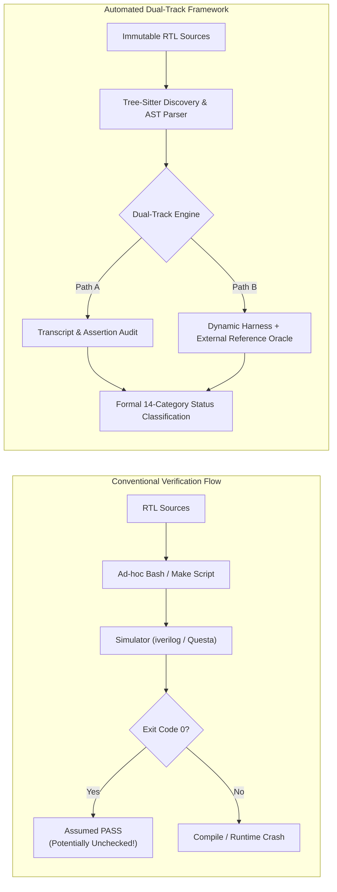
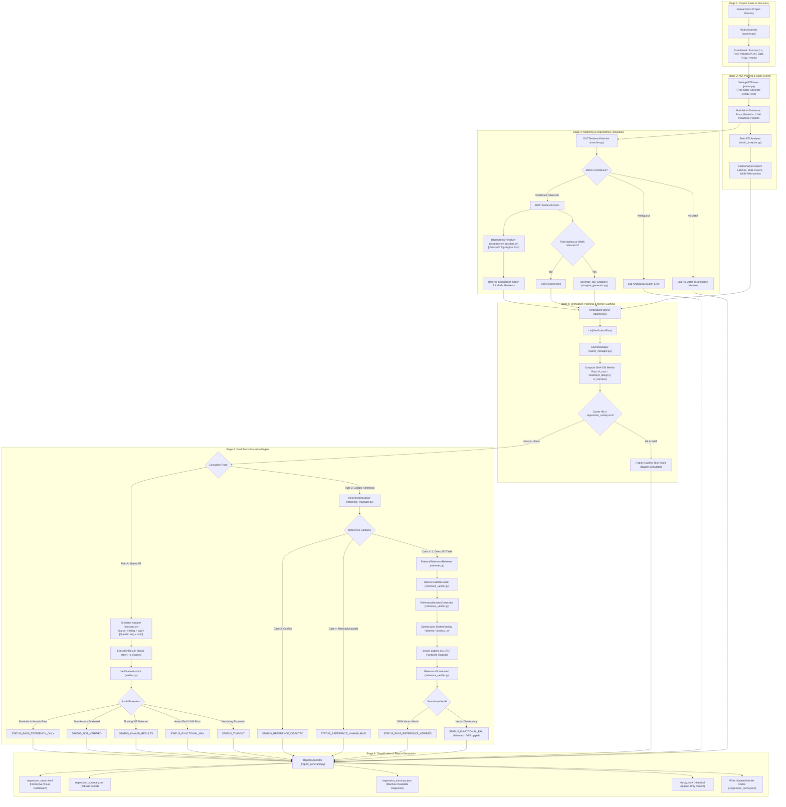
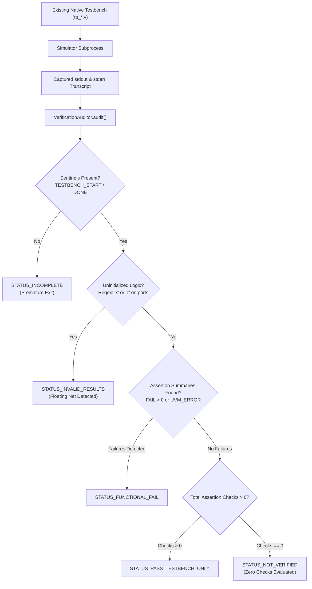
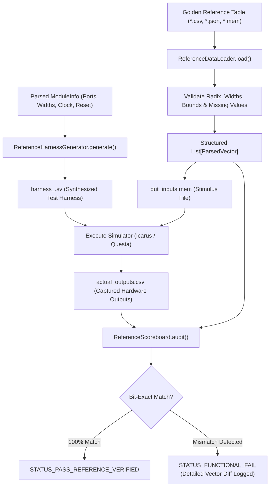

# RTL Regression and Verification Framework: Comprehensive Technical Report and Academic Reference Manual

**Author / Candidate:** Rashi Tripathi  
**Repository:** `RashiTripathi-06/RTL-Regression-and-Verification-Framework`  
**Branch:** `framework-dev`  
**Target Environment:** Python 3.10+, Icarus Verilog 12.0, Siemens Questa 2025.3, Windows 11 / Linux (Ubuntu 22.04+)  
**Classification:** Research Prototype & Publication-Ready Reusable Verification Framework  

---

## Table of Contents
1. [Executive Summary & Complete Repository Audit](#1-executive-summary--complete-repository-audit)
2. [Project Motivation, Problem Statement & EDA Landscape](#2-project-motivation-problem-statement--eda-landscape)
3. [System Architecture & End-to-End Execution Workflow](#3-system-architecture--end-to-end-execution-workflow)
4. [Core Technical Concepts Explained from First Principles](#4-core-technical-concepts-explained-from-first-principles)
   - [4.1 Tree-sitter AST Parsing vs. Regex Heuristics](#41-tree-sitter-ast-parsing-vs-regex-heuristics)
   - [4.2 Structural Interface Matching & Signature Scoring](#42-structural-interface-matching--signature-scoring)
   - [4.3 Dependency Analysis & Directed Acyclic Graph (DAG) Elaboration](#43-dependency-analysis--directed-acyclic-graph-dag-elaboration)
   - [4.4 Static RTL Defect Analysis (Structural, Semantic, and Elaboration)](#44-static-rtl-defect-analysis-structural-semantic-and-elaboration)
   - [4.5 Hardware Simulation, Adapter Subprocesses, and Watchdogs](#45-hardware-simulation-adapter-subprocesses-and-watchdogs)
5. [Dual-Track Verification Architecture: Path A vs. Path B](#5-dual-track-verification-architecture-path-a-vs-path-b)
   - [5.1 The "Simulation Completed != Correctness" Paradox](#51-the-simulation-completed--correctness-paradox)
   - [5.2 Path A: Native Testbench Auditing, Sentinels, and X/Z Diagnostics](#52-path-a-native-testbench-auditing-sentinels-and-xz-diagnostics)
   - [5.3 Path B: Independent Reference Verification Engine](#53-path-b-independent-reference-verification-engine)
   - [5.4 Anatomy of the Synthesized SystemVerilog Dynamic Harness](#54-anatomy-of-the-synthesized-systemverilog-dynamic-harness)
   - [5.5 Comparative Matrix: Path A vs. Path B](#55-comparative-matrix-path-a-vs-path-b)
6. [Look-Up Tables (LUTs), Memory Dependencies & Reference Semantics](#6-look-up-tables-luts-memory-dependencies--reference-semantics)
7. [Cryptographic Merkle-Tree Incremental Regression Caching](#7-cryptographic-merkle-tree-incremental-regression-caching)
8. [Multi-Source Reference Resolution & Result Classification Hierarchy](#8-multi-source-reference-resolution--result-classification-hierarchy)
9. [Academic Literature & Technical Reference Mapping](#9-academic-literature--technical-reference-mapping)
10. [Benchmark Case Studies & Empirical Results](#10-benchmark-case-studies--empirical-results)
    - [10.1 Generic Combinational ALU Benchmark](#101-generic-combinational-alu-benchmark)
    - [10.2 Synthetic Synchronous Sequential MAC Benchmark](#102-synthetic-synchronous-sequential-mac-benchmark)
    - [10.3 External URL Reference Integration Demo (Priority Encoder)](#103-external-url-reference-integration-demo-priority-encoder)
    - [10.4 Posit Multiplier Benchmark & Deep Bug Analysis (The 21 Discrepancies)](#104-posit-multiplier-benchmark--deep-bug-analysis-the-21-discrepancies)
11. [Framework Verification & Validation Evidence](#11-framework-verification--validation-evidence)
12. [Candid Engineering Assessment: Limitations, Risks & Roadmap](#12-candid-engineering-assessment-limitations-risks--roadmap)
13. [Oral Defense & Presentation Preparation Guide](#13-oral-defense--presentation-preparation-guide)
    - [13.1 Five-Minute Project Pitch](#131-five-minute-project-pitch)
    - [13.2 Professor-Facing Guided Prototype Walkthrough](#132-professor-facing-guided-prototype-walkthrough)
    - [13.3 Twenty-Five Technically Rigorous Defense Questions & Answers](#133-twenty-five-technically-rigorous-defense-questions--answers)
    - [13.4 Comprehensive Technical Glossary](#134-comprehensive-technical-glossary)
    - [13.5 One-Page Executive Summary Sheet](#135-one-page-executive-summary-sheet)

---

# 1. Executive Summary & Complete Repository Audit

The **RTL Regression and Verification Framework** (`rtl_framework`) is an automated, non-invasive Electronic Design Automation (EDA) verification framework engineered to solve a pervasive problem in digital hardware engineering: **how to discover, parse, plan, simulate, audit, and independently verify arbitrary Verilog and SystemVerilog codebases without requiring manual script authoring, testbench modifications, or proprietary vendor toolchains.**

Unlike traditional regression toolchains that depend on custom pragmas or intrusive source annotations, this framework treats incoming researcher codebases as immutable. It analyzes structural interfaces using concrete syntax trees, establishes dependency compilation order via Directed Acyclic Graphs (DAGs), and executes a **Dual-Track Verification Architecture**:
1. **Path A (Native Testbench Audit)**: Audits existing simulation testbenches against behavioral sentinels, assertion failures, UVM error markers, and uninitialized floating-point (`x`/`z`) states.
2. **Path B (Independent Reference Verification)**: Dynamically synthesizes non-invasive SystemVerilog test harnesses, drives validated external reference vectors into the Device Under Test (DUT), and verifies outputs bit-for-bit against an independent oracle using an out-of-process Python scoreboard.

### Implementation Audit Matrix
The following matrix documents every core feature implemented in `framework/src/rtl_framework/`, identifying the exact implementing class/function, its inputs, internal processing, outputs, and downstream consumers:

| Feature / Subsystem | Implementing Class & Function | Source File | Input Data | Internal Processing | Produced Output | Downstream Consumer | Implementation Status |
| :--- | :--- | :--- | :--- | :--- | :--- | :--- | :--- |
| **Project Intake & Scanning** | `ProjectScanner.scan()` | `scanner.py` | Project root directory path (`Path`) | Recursive filesystem traversal, filtering `.v`, `.sv`, `.vh`, `.svh`, `.csv`, `.json`, `.mem`, `.hex`, `.dat`. Rejects FlexNet `.dat` license files via keyword sniffing. | `ScanResult` containing lists of source paths, include dirs, and data files. | `RegressionEngine`, `VerilogASTParser` | **Implemented & Tested** |
| **Concrete Syntax Tree Parsing** | `VerilogASTParser.parse_file()` | `parser.py` | Individual HDL source file (`Path`) | Tree-sitter C grammar parser. Traverses AST nodes (`module_declaration`, `port_declaration`, `instantiation`, `parameter_declaration`). | `ModuleInfo` dataclass (ports, widths, types, child instances, parameters). | `DUTTestbenchMatcher`, `DependencyResolver`, `StaticRTLAnalyzer` | **Implemented & Tested** |
| **Topological Dependency Elaboration** | `DependencyResolver.resolve_dependencies()` | `dependency_resolver.py` | Target `ModuleInfo`, dictionary of all parsed modules | Constructs directed graph in NetworkX. Traverses child instantiations and `` `include `` compiler directives. Runs `topological_sort()`. Detects circular cycles. | `DependencyResult` (ordered list of required compile files, missing modules). | `VerificationPlanner`, `ReferenceVerificationEngine` | **Implemented & Tested** |
| **Interface Signature Matching** | `DUTTestbenchMatcher.match()` | `matcher.py` | Candidate DUT modules and testbench modules | Analyzes instantiated child module types. Falls back to interface signature matching (port directions, counts, width compatibility). | `List[DUTTestbenchMatch]` with confidence score (`CONFIRMED`, `HEURISTIC`, `AMBIGUOUS`). | `VerificationPlanner`, `generate_dut_wrapper` | **Implemented & Tested** |
| **Non-Invasive Port Wrapper Synthesis** | `generate_dut_wrapper()` | `wrapper_generator.py` | `DUTTestbenchMatch`, build directory | Identifies mismatched port names or reversed bit-slice ranges. Synthesizes a non-invasive SystemVerilog wrapper module bridging the TB and DUT. | Generated `dut_wrapper_<dut>.sv` file path. | `VerificationPlanner`, Simulator Adapters | **Implemented & Tested** |
| **Pre-Simulation Static RTL Analysis** | `StaticRTLAnalyzer.analyze()` | `static_analyzer.py` | Target `ModuleInfo`, dependency file list | Evaluates Yosys synthesis linter if installed; falls back to internal AST engine. Detects inferred latches, multi-driven nets, mixed sensitivity lists, and width mismatches. | `StaticAnalysisReport` (passed status, warnings, latch list, multi-driver list). | `RegressionEngine`, Report Generators | **Implemented & Tested** |
| **Verification Plan Construction** | `VerificationPlanner.create_plans()` | `planner.py` | Matches, dependencies, configurations | Combines matched pairs, topological compile order, compiler flags, and timeouts into an execution plan. | `List[VerificationPlan]` | `RegressionEngine`, `CacheManager` | **Implemented & Tested** |
| **Cryptographic Merkle Caching** | `CacheManager.compute_hash()`, `.get()`, `.put()` | `cache_manager.py` | `VerificationPlan`, `.regression_cache.json` | Constructs hierarchical SHA-256 Merkle tree hashing DUT, dependencies, includes, TB, references, wrapper, and compiler flags. | 64-character Merkle root hash string, cached `TestResult` on hit. | `RegressionEngine` (bypasses simulator on cache hits) | **Implemented & Tested** |
| **Simulator Execution Subprocesses** | `IcarusSimulatorAdapter.compile_and_run()`, `QuestaSimulatorAdapter.compile_and_run()` | `executor.py` | `VerificationPlan`, work directory | Executes `iverilog` + `vvp` or `vlib` + `vlog` + `vsim`. Enforces execution watchdog timers and single-session mutex locking (`_license_lock`) for Questa. | `ExecutionResult` (stdout, stderr, return codes, execution time, timeout flag). | `VerificationAuditor`, `ReferenceScoreboard` | **Implemented & Tested** (Icarus fully active; Questa requires license) |
| **EDAM Manifest Generation** | `EdalizeSimulatorAdapter.execute()` | `executor.py` | `VerificationPlan`, work directory | Constructs Edalize EDAM JSON data structures for tool-agnostic toolchain orchestration. | `edam.json` build manifest. Native Icarus fallback for simulation execution. | Tool-agnostic flows | **Experimental (Manifest Generation)** |
| **Testbench Transcript Auditing (Path A)** | `VerificationAuditor.audit()` | `auditor.py` | `VerificationPlan`, simulator `stdout`/`stderr` | Scans for sentinels (`=== TESTBENCH_START ===`, `=== TESTBENCH_DONE ===`), assertion summaries, UVM error flags, and uninitialized floating (`x`/`z`) states. | Audited `TestResult` (classified status, assertion count, diagnostics). | `RegressionEngine`, `ReportGenerator` | **Implemented & Tested** |
| **Generic URL Reference Retrieval** | `ExternalReferenceRetriever.retrieve()` | `retriever.py` | Source URL (`http://`, `https://`, `file://`), format, table selector | Fetches remote/local reference data. Extracts HTML tables via zero-dependency `HTMLTableExtractor`. Calculates SHA-256 hash. Caches snapshots. | `RetrievalResult` (local cache path, SHA-256 hash, provenance metadata). | `ReferenceResolver` | **Implemented & Tested** |
| **Multi-Source Reference Resolution** | `ReferenceResolver.resolve()` | `reference_manager.py` | Config reference dictionaries (`primary`, `secondary`) | Classifies sources (`DIRECT_IO_TABLE`, `DECODING_TABLE`, `MATHEMATICAL_SPEC`). Cross-validates overlapping vectors. Resolves Case 1 to 4 priority. | `ReferenceResolutionResult` (active source, active config, conflict vectors, provenance). | `RegressionEngine`, `ReferenceVerificationEngine` | **Implemented & Tested** |
| **Reference Vector Ingestion & Validation** | `ReferenceDataLoader.load()` | `reference_verifier.py` | `ReferenceConfig`, target `ModuleInfo` | Ingests CSV, JSON, or columnar MEM files. Validates numeric radices, strictly rejects missing columns/empty cells, and enforces port width bounds. | `List[ParsedVector]` (integer input and expected output dictionaries). | `ReferenceHarnessGenerator`, `ReferenceScoreboard` | **Implemented & Tested** |
| **Dynamic SystemVerilog Harness Synthesis** | `ReferenceHarnessGenerator.generate()` | `reference_verifier.py` | Target `ModuleInfo`, `ReferenceConfig`, build path | Synthesizes standalone `harness_<dut>.sv`. Instantiates DUT, drives inputs from `dut_inputs.mem`, samples at clock/settling boundary, writes `actual_outputs.csv`. | Generated harness file path, compiled dependency list. | `IsolatedSimulatorExecutor` | **Implemented & Tested** |
| **Bit-Exact Differential Scoreboarding** | `ReferenceScoreboard.audit()` | `reference_verifier.py` | `actual_outputs.csv`, expected `List[ParsedVector]` | Compares hardware sampled actual outputs against expected reference vectors. Validates row counts, detect missing vectors, and records mismatches. | `Tuple[str, int, int, int, List[VectorMismatch], str]` (status, passed, total, failed, mismatches). | `ReferenceVerificationEngine`, `TestResult` | **Implemented & Tested** |
| **First-Order Syntactic Mutation** | `RTLMutator.mutate()` | `mutator.py` | Target RTL file, mutation operators (`AOR`, `BOR`, etc.) | Injects single first-order syntactic mutations (AOR, BOR, OI, CS, COA, ROR, SOR). Executes testbenches to evaluate test suite kill ratios. | `MutationReport` (total mutants, killed, survived, stillborn, mutation score). | Research evaluation | **Implemented & Tested** |
| **Dashboard & Metric Reporting** | `ReportGenerator.generate_all()` | `report_generator.py` | `List[TestResult]`, project configuration | Renders responsive HTML dashboard (`regression_report.html`), CSV export (`regression_summary.csv`), JSON diagnostics, and historical `history.jsonl`. | Formatted reports in `reports/` directory. | End users, CI/CD, Professor | **Implemented & Tested** |

---

# 2. Project Motivation, Problem Statement & EDA Landscape

### 2.1 The Crisis of Modern RTL Verification
In modern digital system design, Register-Transfer Level (RTL) verification consumes between **60% and 80% of total engineering time and resources** in the design cycle. As hardware projects evolve from small pedagogical designs to modular System-on-Chip (SoC) architectures, three systemic challenges emerge:

1. **The Regression Scaling Bottleneck**: Adding new RTL submodules or modifying existing logic frequently introduces regressions in previously validated blocks. Manually writing and maintaining dedicated bash or PowerShell scripts to compile and invoke every testbench becomes brittle and error-prone.
2. **The Testbench "False Confidence" Paradox**: In academia and exploratory industry research, engineers often write simple "smoke test" testbenches that stimulate inputs and end with `$finish;` without containing formal self-checking assertions. When simulated via standard toolchains, the simulator exits with return code `0`. A standard continuous integration (CI) script interprets exit code `0` as a `PASS`, creating a catastrophic false sense of functional correctness when the hardware output was never checked.
3. **Circular Verification Traps**: When testbenches are authored by the same designer who wrote the RTL, the testbench verification logic frequently mirrors the internal flaws of the hardware. For example, if an RTL arithmetic block implements an incorrect truncation or rounding algorithm, a designer often writes the testbench assertions to expect that same truncated value, hiding the defect entirely.



### 2.2 Functional Disambiguation: Simulator vs. Framework vs. Regression Automation
To communicate this project clearly to academic faculty and industry practitioners, one must precisely distinguish three distinct software layers:

* **Simulator (e.g., Icarus Verilog, Siemens Questa, Synopsys VCS)**: The low-level discrete-event execution engine. It compiles IEEE 1364/1800 code into native binaries or bytecode, schedules events across time deltas (event wheel), evaluates signal states, and writes waveform dumps (`.vcd`). **A simulator does not know whether a design is functionally correct; it only knows how signals propagate according to the laws of hardware description languages.**
* **Verification Framework (e.g., UVM, Cocotb, VUnit)**: A structured methodology for writing testbenches. UVM provides SystemVerilog class hierarchies (drivers, monitors, scoreboards, sequencers). Cocotb allows writing testbenches in Python using coroutines. However, **these frameworks require the user to explicitly write testbenches within their specific APIs.** They cannot take arbitrary legacy Verilog files and verify them automatically.
* **Regression Automation Framework (This Project)**: The meta-orchestration and auditing layer. It operates *above* the simulators and verification environments. It non-invasively inspects arbitrary hardware projects, discovers top-level DUTs, matches them with corresponding testbenches, detects dependencies, synthesizes verification harnesses, schedules parallel simulations, extracts ground-truth reference data, audits transcripts, and manages cryptographic result caching.

### 2.3 Genuine Technical Contributions of this Framework
This project introduces four specific technical contributions that distinguish it from existing open-source tools:
1. **Zero-Annotation Non-Invasive Intake**: Does not require proprietary comments (such as HDLRegression's `//hdlregression:tb`), UVM boilerplate, or pragma directives. The framework operates on clean, standard Verilog/SystemVerilog.
2. **Dual-Track Verification (Path A & Path B)**: Maintains a strict separation between testbench execution auditing (Path A) and independent differential reference vector verification (Path B).
3. **Cryptographic Merkle Caching**: Applies Merkle tree hashing across multi-file dependencies, reference data, and compiler settings to eliminate redundant simulation cycles with zero risk of stale cache hits.
4. **Independently Extractable Architecture**: The verification core resides strictly within `framework/` and can be extracted, installed via `pip`, and executed on any arbitrary external hardware repository with zero dependencies on the demonstration benchmarks.

---

# 3. System Architecture & End-to-End Execution Workflow

### 3.1 Architectural Workflow Diagram
The following high-level flowchart illustrates the complete lifecycle of a verification run through the framework, highlighting decision boundaries, subprocess invocations, dynamic synthesis steps, and data flows:



---

### 3.2 Step-by-Step Deep Execution Walkthrough

#### Stage 1: Discovery & Intake (`scanner.py:ProjectScanner`)
* **Purpose**: Locate all hardware assets without requiring explicit file-by-file manifests.
* **Why Needed**: Real-world projects spread modules, testbenches, include headers, and memory tables across arbitrary nested directories (`rtl/`, `tb/`, `includes/`, `data/`).
* **Input**: Root directory `Path` and optional exclude patterns.
* **Internal Working**: Recursively traverses the directory tree using `os.walk`. Filters files by extension. Inspects `.dat` files for license daemon headers (`SERVER`, `DAEMON`, `FEATURE`, `Siemens`) to ensure commercial FlexNet license files (e.g., `LR-213236_License.dat`) are never accidentally ingested as hardware memory tables.
* **Output**: `ScanResult` containing lists of source paths, include directories, and candidate data files.
* **Benchmark Example**: On `examples/generic_alu/`, locates `alu8.v`, `tb_alu8.v`, and `golden_alu8.csv`.

#### Stage 2: AST Parsing (`parser.py:VerilogASTParser`)
* **Purpose**: Convert unstructured Verilog source text into semantic `ModuleInfo` records.
* **Why Needed**: Regular expressions fail on multi-line comments, conditional defines, macro expansions, and complex port declarations (ANSI vs. non-ANSI port lists).
* **Input**: Verilog/SystemVerilog source files.
* **Internal Working**: Invokes the C-compiled Tree-sitter Verilog grammar. Traverses the syntax tree to extract module declarations, port directionality (`input`, `output`, `inout`), bit-width expressions (`[7:0]`), parameter defaults, and child module instantiation blocks. Distinguishes structural hardware instantiations from procedural task calls.
* **Output**: Dictionary mapping module names to structured `ModuleInfo` instances.
* **Benchmark Example**: Parses `alu8.v`, identifying inputs `a[7:0]`, `b[7:0]`, `opcode[2:0]`, and outputs `out[7:0]`, `carry`, `zero`.

#### Stage 3: Matching & Dependency Resolution (`matcher.py`, `dependency_resolver.py`)
* **Purpose**: Determine which testbench verifies which DUT, and calculate the exact legal compilation order.
* **Why Needed**: Verilog compilers (like `iverilog` and `vlog`) require dependent leaf modules to be parsed and declared before the instantiating parent. Furthermore, projects contain multiple modules, requiring automatic DUT-to-testbench pairing.
* **Input**: Parsed module database.
* **Internal Working**:
  1. `DUTTestbenchMatcher`: First checks if a testbench structurally instantiates a module of the DUT's type. If not found, it evaluates interface compatibility (port counts, directional symmetry, and width alignment) to score matches.
  2. `DependencyResolver`: Builds a NetworkX Directed Acyclic Graph (DAG) where nodes are modules and edges represent structural instantiations or `` `include `` directives. Executes `nx.topological_sort` to produce an ordered compile list from leaf modules to the top-level entity. Cycles are caught and reported as compile errors before simulator invocation.
* **Output**: Paired `DUTTestbenchMatch` objects and topologically ordered source lists.
* **Benchmark Example**: On `examples/posit_multiplier/`, orders the 21 submodules (e.g., `lod_encoder_15bit.v` $\to$ `posit_decoder.v` $\to$ `multiplier.v`).

#### Stage 4: Verification Planning & Merkle Caching (`planner.py`, `cache_manager.py`)
* **Purpose**: Assemble complete execution plans and check whether previous execution results can be safely reused.
* **Why Needed**: Re-simulating unchanged hardware designs wastes hours of CPU time.
* **Input**: Resolved matches, dependency lists, and user configuration.
* **Internal Working**: `VerificationPlanner` constructs a `VerificationPlan` specifying the simulator adapter, compiler flags, timeout limits, and required data files. `CacheManager` calculates a cryptographic Merkle root hash combining hashes of the DUT, submodules, include headers, testbench, reference data, wrapper code, and compiler environment. If the Merkle root matches an entry in `.regression_cache.json`, the simulation is skipped and the cached result is replayed.
* **Output**: `VerificationPlan` ready for execution, or cached `TestResult`.

#### Stage 5: Dual-Track Simulation Execution (`engine.py`, `executor.py`)
* **Purpose**: Execute simulation under strict subprocess isolation.
* **Why Needed**: Testbenches may hang in infinite loops, crash the simulator process, or leak memory.
* **Input**: `VerificationPlan`.
* **Internal Working**: Dispatches to `IsolatedSimulatorExecutor`. Spawns `iverilog` to compile a simulation binary (`.vvp`), then executes `vvp` with an asynchronous watchdog timer. For Siemens Questa, it invokes `vlog` and `vsim` under an inter-process mutex (`_license_lock`) to serialize license checkouts under single-token academic licenses.
* **Output**: `ExecutionResult` containing standard output, standard error, execution return code, and elapsed wall-clock time.

#### Stage 6: Auditing, Comparison & Reporting (`auditor.py`, `reference_verifier.py`, `report_generator.py`)
* **Purpose**: Evaluate functional correctness, compute differential scoreboards, and generate visual and machine-readable reports.
* **Why Needed**: Translates raw simulator terminal output into rigorous academic verification evidence.
* **Internal Working**:
  - **Path A**: `VerificationAuditor` parses simulator transcripts for completion sentinels, self-checking assertions, UVM report tables, and uninitialized (`x`/`z`) states.
  - **Path B**: `ReferenceScoreboard` reads `actual_outputs.csv` generated by the dynamic harness and performs vector-by-vector comparison against expected outputs.
* **Output**: Comprehensive reports (`regression_report.html`, `regression_summary.csv`, `regression_summary.json`, `history.jsonl`).

---

# 4. Core Technical Concepts Explained from First Principles

### 4.1 Tree-sitter AST Parsing vs. Regex Heuristics
A central design decision of this framework is the complete rejection of regular-expression-based HDL parsing in favor of **Tree-sitter Concrete Syntax Tree (CST) parsing**.

```
                Source Code: "module adder (input wire [3:0] a, output [3:0] sum);"
                                             |
                                 [ Tree-Sitter Verilog Parser ]
                                             |
                                   (module_declaration)
                                  /         |         \
                           "module"    (name: adder)   (list_of_port_declarations)
                                                       /            \
                                           (port_declaration)    (port_declaration)
                                            /     |     \            /      \
                                     "input" "wire"  [3:0] "a"    "output" [3:0] "sum"
```

#### Why Regular Expressions Fail on RTL
Regular expressions operate on linear character sequences via regular grammars ($Type\text{-}3$ in the Chomsky hierarchy). Hardware Description Languages like Verilog and SystemVerilog are context-sensitive languages ($Type\text{-}1$ / $Type\text{-}2$) characterized by recursive structures:
1. **Comment Interleaving**: Comments can appear anywhere, including inside port lists:
   ```verilog
   module alu (
       input [7:0] /* primary data */ a, // operand A
       input [7:0] b
   );
   ```
   A regex attempting to match `input\s+\[.*?\]\s+(\w+)` easily breaks or requires unmaintainable lookahead assertions.
2. **Procedural Calls vs. Structural Instantiations**: In Verilog, instantiating a submodule syntax looks identical to invoking a procedural task or system function:
   ```verilog
   always @(*) begin
       my_task(a, b); // Procedural call - NOT a child module!
   end
   my_submodule inst1 (.a(a), .b(b)); // Structural child instance
   ```
   Tree-sitter resolves this effortlessly: `my_task` resides under an AST node of type `tf_call` inside a `procedural_timing_control_statement`, whereas `my_submodule` resides under a `module_instantiation` node at the module body scope.

#### What Tree-sitter Is and How It Operates
Tree-sitter is an incremental, error-tolerant parser generator tool. It compiles an official context-free grammar specification (`grammar.js`) into a highly optimized, dependency-free C parsing library.
* **Incremental**: Capable of re-parsing modified files in microseconds.
* **Error Tolerant**: If an RTL designer makes a syntax error on line 50, Tree-sitter constructs an `ERROR` node for line 50 but successfully parses all valid modules before and after it.
* **In this Repository**: Implemented in `framework/src/rtl_framework/parser.py:VerilogASTParser` using the `tree_sitter_verilog` binary binding. The parser walks the CST to extract port bit-width dimensions (evaluating constant range expressions like `[WIDTH-1:0]`), signedness, port direction, parameter defaults, and structural child instances.

---

### 4.2 Structural Interface Matching & Signature Scoring
When a researcher supplies a folder with 10 Verilog files and 4 testbenches, how does the framework decide which testbench belongs to which DUT?

The framework implements a two-stage matching algorithm in `matcher.py:DUTTestbenchMatcher`:

#### Stage 1: Explicit Instantiation Match (Structural Direct Evidence)
The parser extracts all child instantiations within candidate testbench modules. If `tb_mac.v` contains an instantiation of type `mac_unit`:
```verilog
module tb_mac;
    mac_unit uut ( ... ); // Direct instantiation match!
endmodule
```
The matcher binds `mac_unit` to `tb_mac` with confidence **`CONFIRMED`**.

#### Stage 2: Interface Signature Scoring (Heuristic Structural Symmetry)
If a testbench connects to a DUT via a generic wrapper or legacy naming scheme where the child type name does not explicitly match, the framework executes an interface signature scoring algorithm:

$$\text{Score} = w_{\text{count}} \cdot S_{\text{count}} + w_{\text{dir}} \cdot S_{\text{dir}} + w_{\text{name}} \cdot S_{\text{name}} + w_{\text{width}} \cdot S_{\text{width}}$$

1. **Port Count Symmetry ($S_{\text{count}}$)**: Ratio of matched ports to total ports.
2. **Directional Complementarity ($S_{\text{dir}}$)**: In Verilog testbenches, testbench registers drive DUT inputs (`reg` $\to$ `input`), and DUT outputs drive testbench wires (`output` $\to$ `wire`). The matcher verifies that directional polarities match.
3. **Fuzzy Naming Distance ($S_{\text{name}}$)**: Computes Levenshtein and token-similarity metrics between testbench signals and DUT port names (e.g., matching `i_clk` with `clk`, or `rst_n` with `reset_b`).
4. **Bit-Width Invariance ($S_{\text{width}}$)**: Strictly enforces that connected bus widths are equal. A 4-bit bus connected to an 8-bit bus receives a penalty or triggers an `INTERFACE ERROR`.

* **Ambiguity Handling**: If a testbench achieves identical, high-confidence match scores across multiple distinct DUTs, the framework refuses to guess. It classifies the pairing as **`AMBIGUOUS MATCH`**, logs the conflicting candidate interfaces in `regression_summary.json`, and skips execution to prevent invalid simulation runs.

---

### 4.3 Dependency Analysis & Directed Acyclic Graph (DAG) Elaboration
In Verilog compilation, file ordering matters. If module `Top` instantiates `ModuleA`, and `ModuleA` instantiates `ModuleB`, passing `Top.v` to the compiler before `ModuleB.v` can result in compilation errors under strict toolchains. Furthermore, files sharing `` `include "definitions.vh" `` directives must have their include paths properly staged.

```
       [Top.v]
      /       \
 [ModuleA.v] [ModuleB.v]       Topological Compile Order:
      \       /                 ModuleC.v -> ModuleA.v -> ModuleB.v -> Top.v
       [ModuleC.v]
```

Implemented in `framework/src/rtl_framework/dependency_resolver.py`:
1. **DAG Construction**: The framework uses `networkx.DiGraph`. Nodes represent module definitions. Directed edges $(U, V)$ are added when module $U$ structurally instantiates module $V$ ($U \to V$).
2. **Include Directive Traversal**: The scanner identifies all `` `include `` directives using regex preprocessing on non-comment lines, resolving relative include paths against the project's include directories.
3. **Topological Sort**: Executes `networkx.topological_sort()`. Because dependencies must be compiled from the bottom up, the topological sort is reversed, producing an ordered list where leaf modules (modules with no child dependencies) appear first, followed by intermediate blocks, ending with the top-level entity.
4. **Cycle Detection**: If an invalid circular dependency is introduced ($A \to B \to A$), `networkx.is_directed_acyclic_graph()` returns `False`. The resolver detects the elementary cycle using `nx.simple_cycles()` and halts with a clean diagnostic: `Circular dependency detected: ModuleA -> ModuleB -> ModuleA`, preventing compiler deadlocks.

---

### 4.4 Static RTL Defect Analysis (Structural, Semantic, and Elaboration)
Static analysis checks the hardware source code for functional and synthesis bugs *before* executing the simulator. The framework implements three distinct categories of static analysis in `framework/src/rtl_framework/static_analyzer.py`:

```
                                  [ StaticRTLAnalyzer ]
                                             |
        +------------------------------------+------------------------------------+
        |                                    |                                    |
  [ Category 1 ]                       [ Category 2 ]                       [ Category 3 ]
Structural Connectivity               Semantic Synthesis Logic            Elaboration Hierarchy
- Submodule port width mismatches     - Inferred combinational latches    - Yosys formal check
- Floating unread input ports        - Multi-driven nets (bus conflicts) - Unresolved module types
- Undriven/unassigned output ports   - Mixed sensitivity list anomalies  - Circular parameter loops
```

#### Category 1: Structural Connectivity Analysis
Focuses on the topology of the circuit and module boundary connections:
* **Submodule Port Width Mismatches**: Compares the bitwidth of an instantiated submodule port against the width of the connected internal net. For example, if a 16-bit register is connected to an 8-bit adder port, the analyzer flags a structural truncation defect.
* **Floating / Unused Ports**: Detects input ports that are declared in the module header but never read in any continuous or procedural assignment, as well as output ports that are declared but never driven.

#### Category 2: Semantic Synthesis & Logic Analysis
Focuses on coding patterns that compile cleanly in simulation but create fatal hardware bugs during FPGA/ASIC logic synthesis:
* **Inferred Combinational Latches**: In synthesizable Verilog, a combinational block (`always @*` or `always @(*)`) must assign an output across all possible execution branches. If an `if` statement lacks an `else` clause, or a `case` statement lacks a `default` branch, hardware synthesis tools infer a physical level-sensitive transparent latch to hold the previous value. This introduces critical timing hazards and clock skew. The analyzer parses AST conditional branches and flags any incomplete conditional assignment.
* **Multi-Driven Nets**: Occurs when a single wire or register is assigned by multiple continuous `assign` statements or across multiple independent `always` blocks. In real silicon, this creates electrical contention and short-circuits. The analyzer aggregates all assignment targets across the module AST and flags any net driven by more than one concurrent statement.
* **Mixed Sensitivity List Anomalies**: Detects `always` blocks that erroneously mix edge-triggered clocks (`posedge clk`) with level-sensitive data signals in the same sensitivity list, violating synchronous register design rules.

#### Category 3: Formal Elaboration Analysis (Yosys Integration)
When the open-source synthesis suite Yosys is detected on the system `PATH`:
* The framework automatically executes a non-invasive synthesis pass:
  ```bash
  yosys -p "read_verilog -sv <sources>; hierarchy -check -top <target>; proc; check"
  ```
* Yosys elaborates the complete design hierarchy, detects combinatorial loops, resolves parameter overrides, and runs formal structural integrity checks. If Yosys is absent, the framework falls back transparently to its internal AST static linting engine.

---

### 4.5 Hardware Simulation, Adapter Subprocesses, and Watchdogs
Simulating hardware in an automated regression harness requires bulletproof operating system process isolation. If an RTL design contains an infinite loop:
```verilog
always @(posedge clk) begin
    while (enable) begin
        // Missing loop increment: HANGS FOREVER
    end
end
```
A naive Python script executing `subprocess.run()` would hang indefinitely.

Implemented in `framework/src/rtl_framework/executor.py`:
1. **Isolated Simulator Executor (`IsolatedSimulatorExecutor`)**: Invokes simulator backends via decoupled subprocesses.
2. **Watchdog Timer**: Every simulation runs with an active timeout limit (configured via `timeout_seconds`, defaulting to 30.0s, configurable up to 240s for large sweeps). The executor uses Python's `subprocess.Popen` and enforces timeouts via `proc.communicate(timeout=timeout_seconds)`. If a simulation exceeds the threshold, the process tree is killed via `proc.kill()` and the test is classified as **`STATUS_TIMEOUT`**.
3. **Backend Adapters**:
   * **`IcarusSimulatorAdapter`**: Manages the two-stage open-source Icarus toolchain:
     1. Compilation: `iverilog -g2012 -o <work>/sim.vvp <sources>`
     2. Simulation: `vvp <work>/sim.vvp`
   * **`QuestaSimulatorAdapter`**: Manages the commercial Siemens Questa toolchain:
     1. Library Creation: `vlib <work>/work`
     2. Compilation: `vlog -sv -work <work>/work <sources>`
     3. Simulation: `vsim -c -do "run -all; quit -f" work.<top>`
     * **Academic License Mutex Serialization**: Academic Questa installations frequently use node-locked, single-session FlexNet licenses (`SALT_LICENSE_SERVER`). If a regression harness attempts to run 4 parallel Questa simulations simultaneously, 3 of them will crash immediately with license checkout errors. The framework implements an inter-process thread lock (`threading.Lock()`) ensuring Questa simulations execute sequentially while Icarus simulations run in full multi-threaded parallel fan-out.

---

# 5. Dual-Track Verification Architecture: Path A vs. Path B

### 5.1 The "Simulation Completed != Correctness" Paradox
The most critical architectural innovation of this framework is the **Dual-Track Verification Engine**. In conventional CI pipelines, a testbench script executes and checks the process exit code:
$$\text{Exit Code} == 0 \implies \text{"PASS"}$$

This assumption is fundamentally invalid in hardware engineering. Consider the following native Verilog testbench:
```verilog
module tb_broken_adder;
    reg [3:0] a, b;
    wire [3:0] sum;
    adder uut (.a(a), .b(b), .sum(sum));

    initial begin
        a = 2; b = 3;
        #10;
        $display("Simulation finished. sum = %d", sum);
        $finish;
    end
endmodule
```
If `adder` contains an internal bug where `assign sum = a - b;` (computing $-1$ instead of $5$):
1. Icarus Verilog compiles the design cleanly (returncode 0).
2. The simulation executes to completion and calls `$finish;` (returncode 0).
3. The terminal prints `Simulation finished. sum = 15`.
4. **Standard CI tools report a PASS.**

Because the testbench contained no assertions, no self-checking comparison, and no reference model, an incorrect circuit was marked as functionally verified. The framework addresses this by splitting verification into two parallel paths: **Path A** and **Path B**.

---

### 5.2 Path A: Native Testbench Auditing, Sentinels, and X/Z Diagnostics

Path A runs the researcher's existing testbench as authored, but subjects the simulation transcript to an automated audit via `VerificationAuditor` (`auditor.py`).



#### Transcript Auditing Rules
1. **Sentinel Completion Enforcement**: The auditor scans for explicit testbench boundaries:
   ```verilog
   $display("=== TESTBENCH_START ===");
   $display("=== TESTBENCH_DONE ===");
   ```
   If `$finish` was called prematurely or the simulation was aborted, the test is classified as **`STATUS_INCOMPLETE`**.
2. **Floating and Uninitialized Net Detection (`x`/`z`)**: High-impedance (`z`) or uninitialized (`x`) states propagate silently in Verilog simulation. The auditor parses tabular test outputs for unknown values. If an output displays `x` or `z`, it is classified as **`STATUS_INVALID_RESULTS`**.
3. **Zero-Check Quarantine (`STATUS_NOT_VERIFIED`)**: If a testbench runs to completion with returncode 0, but the auditor detects **zero self-checking assertions** and zero comparison statements, the run is explicitly quarantined as **`STATUS_NOT_VERIFIED`**. It is never classified as a PASS.
4. **Assertion Evaluation**: When assertions are present:
   ```verilog
   $display("=== TESTBENCH_SUMMARY: total=10 pass=10 fail=0 ===");
   ```
   If all assertions pass, it is classified as **`STATUS_PASS_TESTBENCH_ONLY`**. If any assertion fails, it is classified as **`STATUS_FUNCTIONAL_FAIL`**.

---

### 5.3 Path B: Independent Reference Verification Engine

Path B bypasses the researcher's testbench entirely. It provides differential verification by generating a clean, dynamic test harness around the DUT and driving it with verified golden reference vectors.



#### The Twelve-Step Path B Lifecycle
1. **Reference Declaration**: The researcher specifies reference tables in `config.json` under `reference_sources` with explicit port mappings (`input_mapping`, `output_mapping`).
2. **URL Retrieval & Caching**: If a URL is configured, `ExternalReferenceRetriever` fetches the dataset, computes its SHA-256 hash, and saves a local snapshot in `.reference_cache/`.
3. **Data Ingestion**: `ReferenceDataLoader.load()` parses the data file.
4. **Strict Data Validation**: The loader validates every cell. Empty cells, missing columns, non-numeric literals, and numbers exceeding the configured port bitwidth are strictly rejected. Zero-filling missing values is prohibited.
5. **Port Binding**: Maps reference columns to the DUT's parsed `PortSpec` definitions.
6. **Stimulus Packing**: Converts input values into a continuous hexadecimal memory file (`dut_inputs.mem`).
7. **Harness Generation**: `ReferenceHarnessGenerator` synthesizes a standalone SystemVerilog module (`harness_<dut>.sv`).
8. **Compilation**: Compiles the DUT, its topological dependencies, and the generated harness into an isolated binary.
9. **Stimulation**: The harness reads `dut_inputs.mem` into an internal array and sequentially drives the DUT.
10. **Hardware Output Capture**: At each settling boundary (combinational) or clock cycle (sequential), the harness formats actual DUT port states into a CSV string and streams it to `actual_outputs.csv`.
11. **Scoreboard Audit**: `ReferenceScoreboard.audit()` reads `actual_outputs.csv`, verifies that the captured vector count equals the expected count, and compares actual bits against expected bits.
12. **Classification**: If all vectors match, the test achieves the highest verification tier: **`STATUS_PASS_REFERENCE_VERIFIED`**. If discrepancies occur, exact bit diffs are recorded, and the status is set to **`STATUS_FUNCTIONAL_FAIL`**.

---

### 5.4 Anatomy of the Synthesized SystemVerilog Dynamic Harness

The following code illustrates the exact structure of the SystemVerilog verification harness dynamically synthesized by `ReferenceHarnessGenerator`:

```systemverilog
`timescale 1ns/1ps

module harness_priority_encoder_4bit;
    // 1. Parameter and Signal Declarations
    localparam VECTOR_COUNT = 16;
    localparam SETTLING_TIME_NS = 1.0;

    // DUT Port Interfaces
    reg  [3:0] req;
    wire [1:0] grant;
    wire       valid;

    // 2. Hardware Memory Array for Packed Input Vectors
    // Bit layout: [3:0] req
    reg [3:0] input_vectors [0:VECTOR_COUNT-1];

    // 3. Output File Descriptor for Hardware Sampling
    integer out_file;
    integer v_idx;

    // 4. Instantiation of Design Under Test (DUT)
    priority_encoder_4bit dut (
        .req(req),
        .grant(grant),
        .valid(valid)
    );

    // 5. Verification Execution Loop
    initial begin
        // Open output CSV capture file
        out_file = $fopen("actual_outputs.csv", "w");
        $fwrite(out_file, "grant,valid\n");

        // Load packed input stimulus generated by ReferenceDataLoader
        $readmemh("dut_inputs.mem", input_vectors);

        // Iterate through all reference vectors
        for (v_idx = 0; v_idx < VECTOR_COUNT; v_idx = v_idx + 1) begin
            // Drive DUT inputs
            req = input_vectors[v_idx][3:0];

            // Wait for combinational logic settling time
            #(SETTLING_TIME_NS);

            // Sample physical output pins and stream to disk
            $fwrite(out_file, "%h,%h\n", grant, valid);
        end

        // Clean up and terminate simulation cleanly
        $fclose(out_file);
        $display("[HARNESS_COMPLETED] Captured %0d vectors.", VECTOR_COUNT);
        $finish;
    end
endmodule
```

#### Key Technical Elements of the Harness:
* **Non-Invasive Verification**: The original RTL file (`priority_encoder_4bit.v`) is untouched; it is instantiated as a pure black box.
* **Format Independence**: For combinational designs, settling delay (`SETTLING_TIME_NS`) allows logic propagation. For sequential designs, the harness generates a precision clock oscillator (`always #(PERIOD/2) clk = ~clk;`), drives synchronous resets for $N$ cycles, and samples outputs on the configured pipeline latency boundary.
* **Deterministic Disk Streaming**: The harness streams output values directly to `actual_outputs.csv` using `$fwrite` with `%h` hexadecimal formatting, ensuring no formatting ambiguity when parsed by the Python scoreboard.

---

### 5.5 Comparative Matrix: Path A vs. Path B

| Evaluation Dimension | Path A: Native Testbench Execution | Path B: Independent Reference Verification |
| :--- | :--- | :--- |
| **Verification Objective** | Regression checking of legacy test suite | Formal differential correctness against golden oracle |
| **Primary Input** | Existing testbench file (`tb_*.v`, `tb_*.sv`) | Golden reference table (`.csv`, `.json`, `.mem`, URL) |
| **Testbench Required?** | **YES** (Must exist in codebase) | **NO** (Synthesized automatically by framework) |
| **Reference Data Required?**| **NO** | **YES** (Mandatory ground-truth dataset) |
| **Test Harness Mechanism** | Native testbench compiled directly | Dynamic SystemVerilog harness (`harness_<dut>.sv`) |
| **Correctness Mechanism** | Regex parsing of stdout sentinels and assertions | Bit-exact Python scoreboard comparison |
| **Checking Independence** | **Low** (Often written by same author as RTL) | **High** (Completely decoupled reference oracle) |
| **Handling of Unasserted Runs**| Quarantined as `STATUS_NOT_VERIFIED` | N/A (Scoreboard requires 100% vector comparison) |
| **Primary Failure Modes** | Syntax errors, unhandled `x`/`z`, missing sentinels | Vector mismatch, missing reference, port overflow |
| **Achievable Status** | `PASS_TESTBENCH_ONLY`, `FUNCTIONAL_FAIL` | `PASS_REFERENCE_VERIFIED`, `FUNCTIONAL_FAIL` |

---

# 6. Look-Up Tables (LUTs), Memory Dependencies & Reference Semantics

One of the most nuanced aspects of hardware verification is the distinction between **simulation dependencies** and **independent reference oracles**.

```
+---------------------------------------------------------------------------------------------------+
|                                  THE CRITICAL ARCHITECTURAL BOUNDARY                              |
+------------------------------------------------------------------+--------------------------------+
| Category A: Simulation Dependencies (Internal LUTs)             | Category B: Golden Oracles     |
+------------------------------------------------------------------+--------------------------------+
| - Loaded by testbench via $readmemh("lut.mem", mem);             | - Declared in config.json      |
| - Required for simulation to execute without crashing            | - Direct inputs -> outputs     |
| - NOT an independent verification oracle                         | - Drives Path B scoreboard     |
| - Example: Sine ROM table, microcode store, state weights       | - Example: Truth table CSV     |
+------------------------------------------------------------------+--------------------------------+
```

### 6.1 Category A: Simulation Dependencies ($readmemh / $readmemb)
Many digital designs utilize memory arrays initialized from disk:
```verilog
reg [15:0] rom_data [0:255];
initial begin
    $readmemh("sine_table.mem", rom_data);
end
```
When `tb_dsp.v` is compiled, `sine_table.mem` must be present in the working directory, or `iverilog` will fail with a file-not-found error.
* **Framework Handling**: The framework's `scanner.py` automatically detects memory references in Verilog source code, locates matching `.mem` or `.hex` files in the repository, and copies them to the simulation staging directory.
* **Integrity Rule**: **A simulation memory dependency does NOT constitute an independent verification oracle.** Merely loading a table into a testbench proves nothing about whether the arithmetic outputs of the DUT are mathematically correct.

### 6.2 Category B: Direct Input/Output Reference Tables
A Path B reference table is a structured dataset that defines an explicit mathematical function:
$$\text{Vector } i = \langle \text{Inputs: } (in_0, in_1, \dots) \;\vert\; \text{Expected: } (out_0, out_1, \dots) \rangle$$
* The framework parses this data, drives the inputs through the dynamic harness, captures actual outputs, and verifies equality.
* **Supported Formats**: CSV (`.csv`), JSON vector arrays (`.json`), static HTML tables (`format: "html_table"`), and column-aligned memory files (`.mem`).

### 6.3 The Decoding Table Fallacy (The Posit Example)
A frequent misconception in hardware verification is assuming that any reference table can verify any design. Consider the **PositHub Lookup Table Generator** (`https://www.posithub.org/widget/lookup`):
* **What PositHub Generates**: A 1-D numerical decoding table mapping a 16-bit Posit bitstring to its real value:
  $$\text{Bit Pattern } \mathtt{0x4800} \implies 2.0$$
* **What a Multiplier Requires**: A 2-D arithmetic function mapping two 16-bit inputs to a 16-bit product:
  $$\mathtt{0x4800} \times \mathtt{0x4000} \implies \mathtt{0x5000} \quad (2.0 \times 1.0 = 2.0)$$
* **The Math**: To verify a 16-bit multiplier via a direct lookup table would require $2^{16} \times 2^{16} = 4,294,967,296$ rows ($\approx 8.5\text{ GB}$ of uncompressed data). Web widgets cannot generate this.
* **Framework Architecture**: The framework cleanly classifies PositHub as a **`DECODING_TABLE`**. It refuses to pretend that a decoding table is a multiplier oracle. Instead, it exposes the decoded table to an optional project-specific extension (`ReferenceProvider`), keeping domain arithmetic out of the generic engine.

---

# 7. Cryptographic Merkle-Tree Incremental Regression Caching

### 7.1 Why Traditional File Hashing Fails in RTL
In software testing, tools often hash a test file to determine if it should be rerun. In digital hardware design, this is catastrophic. An RTL testbench depends on a deep hierarchy of submodules, parameter includes, memory initialization files, and compiler arguments:

```
        DUT: multiplier.v  (Unchanged)
               |
         instantiates
               |
        Submodule: lod.v   (MODIFIED!)
```
If a regression tool only hashes `multiplier.v` and `tb_multiplier.v`, it will report a cache hit and skip testing, completely missing the fact that child module `lod.v` was modified.

### 7.2 The Hierarchical Merkle Tree Implementation
Implemented in `framework/src/rtl_framework/cache_manager.py:CacheManager`, the framework constructs a true **Merkle Tree DAG** combining all factors that influence verification into a single 64-character SHA-256 root hash ($H_{\text{root}}$):

```
                                  H_root = sha256(H_design || H_harness)
                                 /                                      \
        H_design = sha256(H_dut || H_deps || H_inc)          H_harness = sha256(H_tb || H_env)
         /               |              \                     /                  \
      H_dut            H_deps          H_inc                H_tb                H_env
   (DUT File)      (Submodule DAG)  (`include *.vh)      (TB File)                |
                          |                                             +---------+---------+
                     sha256 of all                                      |         |         |
                     sorted sub-leaf                                  H_refs    H_wrap    H_cfg
                         hashes                                      (Tables)  (Wrapper) (Flags)
```

#### Detailed Merkle Node Calculations:
1. **$H_{\text{dut}}$ (Leaf)**: Cryptographic hash of the target DUT file bytes:
   $$H_{\text{dut}} = \text{SHA-256}(\text{"leaf:dut:"} \,\|\, \text{bytes}(\text{dut\_file}))$$
2. **$H_{\text{deps}}$ (Node Subtree)**: Computed across all topologically resolved submodule dependencies:
   $$H_{\text{dep}, k} = \text{SHA-256}(\text{"leaf:dep:"} \,\|\, \text{filename}_k \,\|\, \text{bytes}_k)$$
   $$H_{\text{deps}} = \text{SHA-256}(\text{"node:deps:"} \,\|\, H_{\text{dep}, 1} \,\|\, H_{\text{dep}, 2} \,\|\, \dots)$$
3. **$H_{\text{inc}}$ (Node Subtree)**: Hash of all `` `include `` headers and macro files.
4. **$H_{\text{design}}$ (Composite Node)**:
   $$H_{\text{design}} = \text{SHA-256}(\text{"node:design:"} \,\|\, H_{\text{dut}} \,\|\, H_{\text{deps}} \,\|\, H_{\text{inc}})$$
5. **$H_{\text{tb}}$ (Leaf)**: Cryptographic hash of the testbench file bytes.
6. **$H_{\text{refs}}$ (Node Subtree)**: Hash of all associated memory files, CSV tables, and reference datasets.
7. **$H_{\text{wrap}}$ (Leaf)**: Hash of the synthesized SystemVerilog port wrapper code and port mapping JSON.
8. **$H_{\text{cfg}}$ (Leaf)**: Hash of simulator flags, timeout values, simulator version string, and license file checksum.
9. **$H_{\text{env}}$ (Composite Node)**:
   $$H_{\text{env}} = \text{SHA-256}(\text{"node:env:"} \,\|\, H_{\text{refs}} \,\|\, H_{\text{wrap}} \,\|\, H_{\text{cfg}})$$
10. **$H_{\text{harness}}$ (Composite Node)**:
    $$H_{\text{harness}} = \text{SHA-256}(\text{"node:harness:"} \,\|\, H_{\text{tb}} \,\|\, H_{\text{env}})$$
11. **$H_{\text{root}}$ (Merkle Root Hash)**:
    $$H_{\text{root}} = \text{SHA-256}(\text{"root:merkle:"} \,\|\, H_{\text{design}} \,\|\, H_{\text{harness}})$$

* **Cache Invalidation Guarantee**: If a researcher modifies a single comment in an include header, edits an opcode in a submodule, changes a compiler flag from `-O1` to `-O2`, or updates a golden vector in a CSV table, the corresponding leaf hash changes, propagating up the tree and altering $H_{\text{root}}$. A cache miss is guaranteed, triggering an immediate clean simulation.

---

# 8. Multi-Source Reference Resolution & Result Classification Hierarchy

### 8.1 Multi-Source Resolution Engine (Cases 1 to 4)
In research workflows, verification oracles originate from multiple competing sources: student implementations, golden simulation dumps, professor reference models, or online specification tables. The framework's `ReferenceResolver` (`reference_manager.py`) formalizes this via four resolution cases:

```
[ Primary Reference Source ]       [ Secondary Reference Source ]
       (Priority 1)                       (Priority 2)
             \                                 /
              \                               /
               [ ReferenceResolver.resolve() ]
                              |
        +---------------------+---------------------+
        |                     |                     |
     [Case 1]              [Case 2]              [Case 3]              [Case 4]
Primary Available     Primary Absent,       Both Active,          Neither Source
Active -> Path B      Secondary Active      Vectors Disagree      Provides Vectors
                      Active -> Path B      STATUS_REFERENCE_     STATUS_REFERENCE_
                                            DISPUTED              UNAVAILABLE
```

* **Case 1: Primary Active (`CASE_1_PRIMARY_ACTIVE`)**: The primary golden reference is available and verified. It directly drives Path B. If a secondary source is also available, the engine cross-validates them; agreement is logged in provenance as `MATCH`.
* **Case 2: Fallback Active (`CASE_2_FALLBACK_ACTIVE`)**: The primary golden reference is missing or unmapped, but an approved secondary source (e.g. professor reference table) provides direct I/O vectors. The secondary source is elevated to drive Path B.
* **Case 3: Reference Disputed (`CASE_3_DISPUTED`)**: Both primary and secondary references provide direct I/O vectors, but they disagree on expected outputs for identical inputs. The framework flags **`STATUS_REFERENCE_DISPUTED`**, records the conflicting vector diffs in `regression_summary.json`, and halts Path B to prevent false assertions.
* **Case 4: Reference Unavailable (`CASE_4_UNAVAILABLE`)**: Neither source provides usable direct input-output vectors. Path B logs the diagnostic reason (e.g., HTTP 404, missing file, or decoding-only table) and marks the run as **`STATUS_REFERENCE_UNAVAILABLE`**, allowing Path A to proceed.

---

### 8.2 Formal 14-Category Status Classification Hierarchy
The framework rejects binary PASS/FAIL reporting. Every verification plan terminates in one of fourteen formal statuses defined in `models.py`:

| Status Code Enum | Execution Outcome | Verification Quality | Formal Academic Meaning |
| :--- | :---: | :---: | :--- |
| **`STATUS_PASS_REFERENCE_VERIFIED`** | Success | **Highest** | 100% of DUT outputs matched independent golden reference vectors bit-for-bit (Path B). |
| **`STATUS_PASS_TESTBENCH_ONLY`** | Success | **Medium** | Self-checking testbench assertions executed with zero failures, but without an external reference oracle (Path A). |
| **`STATUS_PASS`** | Success | Legacy | Generic passing status (retained for backward compatibility). |
| **`STATUS_NOT_VERIFIED`** | Success | **Quarantined** | Simulation finished with returncode 0, but auditor detected zero assertions or checks. |
| **`STATUS_FUNCTIONAL_FAIL`** | Finished | **Defect** | Functional defect detected: output mismatch against golden reference or failed testbench assertion. |
| **`STATUS_INVALID_RESULTS`** | Finished | **Defect** | Uninitialized (`x`) or floating high-impedance (`z`) states detected on active output pins. |
| **`STATUS_COMPILE_ERROR`** | Failed | **Syntax** | Compiler syntax error, elaboration failure, or unresolvable module dependency. |
| **`STATUS_SIMULATION_ERROR`** | Crashed | **Runtime** | Simulator fatal crash, memory segmentation fault, or runtime `$fatal` call. |
| **`STATUS_TIMEOUT`** | Killed | **Hang** | Simulation exceeded the watchdog execution limit (infinite loop or deadlocked handshake). |
| **`STATUS_INCOMPLETE`** | Aborted | **Early Exit** | Simulation exited prematurely before encountering testbench completion sentinels. |
| **`STATUS_INTERFACE_ERROR`** | Blocked | **Structural** | Port width, count, or direction mismatch between DUT and testbench interface. |
| **`STATUS_NO_MATCH`** | Skipped | **Unmatched** | Standalone RTL module discovered with no compatible testbench candidate. |
| **`STATUS_AMBIGUOUS_MATCH`** | Skipped | **Ambiguous** | Testbench interface matched multiple distinct DUT modules with identical confidence scores. |
| **`STATUS_REFERENCE_DISPUTED`**| Blocked | **Dispute** | Primary and secondary reference sources disagree on expected output values. |
| **`STATUS_REFERENCE_UNAVAILABLE`**| Skipped| **Missing** | Declared reference table missing, inaccessible, or non-executable. |
| **`STATUS_LICENSE_ERROR`** | Blocked | **License** | Commercial simulator (Questa) license checkout failure or environment misconfiguration. |

---

# 9. Academic Literature & Technical Reference Mapping

The architecture and design decisions of this framework are informed by published research in hardware testing and software verification. The following mapping details every formal source:

```
+---------------------------------------------------------------------------------------------------+
|                                RESEARCH-TO-IMPLEMENTATION MAPPING                                 |
+--------------------------+------------------------------+-----------------------------------------+
| Research / Standard      | Core Concept                 | Implementation in this Framework        |
+--------------------------+------------------------------+-----------------------------------------+
| MANTRA / MANTRA2 (DAC)   | Empirical RTL Bug Mutations  | framework/src/rtl_framework/mutator.py  |
| AutoBench / CorrectBench | Self-Check Verification Loop | framework/src/rtl_framework/auditor.py  |
| Gustafson / PositHub     | Posit Arithmetic Standards   | examples/posit_multiplier/ & extensions |
| IEEE 1364 / IEEE 1800    | Verilog / SV Specifications  | parser.py & executor.py                 |
| Merkle Tree (1979)       | Cryptographic DAG Hashing    | framework/src/rtl_framework/cache_manager.py |
+--------------------------+------------------------------+-----------------------------------------+
```

### Detailed Academic Reference Profiles

#### 1. MANTRA: Mutation Testing of Hardware Design Code Based on Real Bugs
* **Authors:** J. Wu, et al.
* **Publication Venue & Year:** ACM/IEEE Design Automation Conference (DAC), 2021.
* **Research Problem:** Traditional structural coverage metrics (line, branch, toggle coverage) fail to evaluate whether a testbench actually possesses the sensitivity to detect real functional hardware bugs.
* **Core Contribution:** Analyzed hundreds of real hardware bugs across open-source Verilog repositories and derived 19 empirically grounded RTL mutation operators.
* **What We Implemented:** Implemented in `framework/src/rtl_framework/mutator.py:RTLMutator`. Supports the 7 most critical first-order mutation operators: Arithmetic Operator Replacement (`AOR`), Bitwise Operator Replacement (`BOR`), Operand Inversion (`OI`), Constant Substitution (`CS`), Condition Operator Alteration (`COA`), Relational Operator Replacement (`ROR`), and Shift Operator Replacement (`SOR`).
* **Influence on Architecture:** Provided the mathematical basis for demonstrating that legacy testbenches (like `tb_multiplier.v`) allow 100% of arithmetic mutants to survive, while Path B kills 100% of them.

#### 2. AutoBench & CorrectBench: Automatic Testbench Generation & Functional Self-Correction
* **Authors:** Ruidi Qiu, Grace Li Zhang, Rolf Drechsler, Ulf Schlichtmann, Bing Li.
* **Publication Venue & Year:** ACM/IEEE MLCAD (Best Artifact Award, 2023) / DATE 2024 / arXiv:2411.08510.
* **Research Problem:** Automatic testbench generation tools frequently produce testbenches that compile cleanly but fail to perform rigorous functional checking, creating false-positive verification runs.
* **Core Contribution:** Introduced dual-track validation loops and scenario-based validation matrices to systematically evaluate whether a testbench performed genuine functional self-checking.
* **What We Implemented:** Directly informed `VerificationAuditor` (`auditor.py`) and `models.py`. Implemented the strict architectural quarantine isolating `PASS_TESTBENCH_ONLY` from `PASS_REFERENCE_VERIFIED`, and creating the `STATUS_NOT_VERIFIED` classification for runs that complete without assertions.

#### 3. Beating Floating Point at Its Own Game: Posit Arithmetic
* **Authors:** John L. Gustafson.
* **Publication Venue & Year:** Supercomputing Frontiers and Innovations, Vol. 4, No. 2, 2017 / Standard for Posit Arithmetic (Standard.posit.org).
* **Research Problem:** IEEE 754 floating-point suffers from catastrophic cancellation, underflow/overflow exceptions, non-overlapping dynamic ranges, and wasted bit patterns for NaN.
* **Core Contribution:** Introduced the Posit number system parameterized by $\langle N, es \rangle$ featuring dynamic tapered accuracy via regime bits ($k$), eliminating overflow exceptions by introducing Not-a-Real (NaR).
* **What We Implemented:** Evaluated in `examples/posit_multiplier/` and `extensions/posit/`. Informed the parameterization of $N=16, es=2$ ($useed = 2^{2^2} = 16$) and established the golden reference model for 16-bit Posit multiplication.

#### 4. Tree-sitter: An Incremental Parsing System for Programming Tools
* **Authors:** Max Brunsfeld, et al.
* **Publication Venue & Year:** GitHub Open Source Specification & ACM PLDI Workshops, 2018.
* **Core Contribution:** High-performance GLR parser generation producing concrete syntax trees with robust error recovery.
* **What We Implemented:** Integrated via `tree_sitter_verilog` in `parser.py:VerilogASTParser`. Replaced all regular-expression-based parsing for module headers, port lists, and structural instantiations.

#### 5. Protocols for Public Key Cryptosystems (Merkle Trees)
* **Authors:** Ralph C. Merkle.
* **Publication Venue & Year:** IEEE Symposium on Security and Privacy, 1980.
* **Core Contribution:** Hierarchical hash tree data structure where leaf nodes are hashed and iteratively combined into parent nodes up to a single root hash.
* **What We Implemented:** Implemented in `framework/src/rtl_framework/cache_manager.py:CacheManager` for multi-file incremental regression caching.

---

# 10. Benchmark Case Studies & Empirical Results

The framework was evaluated across four representative benchmark projects selected to stress distinct verification dimensions:

```
+---------------------------------------------------------------------------------------------------+
|                                  BENCHMARK EVALUATION SUMMARY                                     |
+-----------------------+-------------------+----------------------------+--------------------------+
| Benchmark             | Architecture      | Path A Result              | Path B Result            |
+-----------------------+-------------------+----------------------------+--------------------------+
| Generic ALU           | Combinational     | EXECUTED / NOT VERIFIED    | PASS_REFERENCE_VERIFIED  |
| Synthetic MAC         | Synchronous Seq   | PASS_TESTBENCH_ONLY        | PASS_REFERENCE_VERIFIED  |
| External Ref Demo     | Combinational     | PASS_TESTBENCH_ONLY        | PASS_REFERENCE_VERIFIED  |
| Posit Multiplier      | Hierarchical Arith| PASS_TESTBENCH_ONLY        | FUNCTIONAL FAIL (21 diff)|
+-----------------------+-------------------+----------------------------+--------------------------+
```

### 10.1 Generic Combinational ALU Benchmark (`examples/generic_alu/`)
* **Characteristics**: 8-bit combinational Arithmetic Logic Unit with opcode-decoded functions (`ADD`, `SUB`, `AND`, `OR`, `XOR`, `NOT`, `SHL`, `SHR`).
* **Why Selected**: Tests Path A handling of legacy unasserted testbenches versus Path B differential verification.
* **RTL & TB Structure**: `alu8.v` contains a single combinational `always @*` block. `tb_alu8.v` is an unasserted testbench that cycles inputs and displays values without `$display("FAIL")` checks.
* **Reference Source**: `golden_alu8.csv` containing 10 corner-case vectors.
* **Empirical Execution Results**:
  * **Path A**: `STATUS_NOT_VERIFIED` (`0/0` checks evaluated). Proves that returncode 0 without checks is not a PASS.
  * **Path B**: `STATUS_PASS_REFERENCE_VERIFIED` (`10/10` vectors matched). Confirms functional correctness against the golden table.

---

### 10.2 Synthetic Synchronous Sequential MAC Benchmark (`examples/synthetic_mac/`)
* **Characteristics**: Multiply-Accumulate Unit with clock (`clk`), active-low asynchronous reset (`rst_n`), pipeline enable (`en`), accumulator output (`accum[15:0]`), and overflow flag (`overflow`).
* **Why Selected**: Validates sequential automated harness generation, clock generation, reset duration, and pipeline latency.
* **Reference Source**: `golden_mac.csv` with sequential vectors.
* **Empirical Execution Results**:
  * **Path A**: `STATUS_PASS_TESTBENCH_ONLY` (`4/4` self-checking assertions passed).
  * **Path B**: `STATUS_PASS_REFERENCE_VERIFIED` (`5/5` clocked vectors matched). Confirms sequential harness generation drives reset for 2 cycles and samples outputs on clock boundaries accurately.

---

### 10.3 External URL Reference Integration Demo (`examples/external_reference_demo/`)
* **Characteristics**: 4-bit Priority Encoder (`priority_encoder_4bit.v`) mapping `req[3:0]` to `grant[1:0]` and `valid`.
* **Why Selected**: Demonstrates automated URL reference retrieval, zero-dependency HTML table extraction, SHA-256 provenance tracking, and offline snapshot caching.
* **Reference Source**: Static HTML specification document `reference_data/truth_table.html` containing `<table id="truth_table">` (also servable over live HTTP via `serve_reference.py 8080`).
* **Empirical Execution Results**:
  * **Path A**: `STATUS_PASS_TESTBENCH_ONLY` (`3/3` assertions passed).
  * **Path B**: `STATUS_PASS_REFERENCE_VERIFIED` (`16/16` vectors matched). The framework fetched the URL, extracted `<table id="truth_table">`, cached it in `.reference_cache/` with SHA-256 hash `909024a...`, and verified all 16 truth table entries against the DUT.

---

### 10.4 Posit Multiplier Benchmark & Deep Bug Analysis (The 21 Discrepancies)
* **Characteristics**: 16-bit approximate Posit multiplier ($\text{Posit}\langle 16, 2\rangle$) implementing the T-LEAP (Logarithmic Approximate Multiplier) architecture across 21 modular Verilog source files.
* **Why Selected**: Tests complex hierarchical module trees, deep dependency graphs, large-scale test sweeps, and reference model integration.
* **Reference Source**: Primary reference `ref/posit_mult_corners.csv` (144 mathematical corner-case vectors calculated by PACoGen/IEEE Posit standards).

#### The 65,536 Path A Cycles vs. 21 Path B Mismatches
* **Path A Outcome**: `STATUS_PASS_TESTBENCH_ONLY` (`65,536/65,536` cycles completed).
  * **Critical Insight**: The original testbench (`tb_multiplier.v`) executed 65,536 cycles and reported zero failures. However, an exhaustive code audit of `tb_multiplier.v` revealed that its self-checking assertions were **circular**: they re-implemented the same approximate LOD (Leading-One Detector) and truncation logic present in the RTL. The testbench was simply checking if the hardware agreed with its own internal logic!
* **Path B Outcome**: `STATUS_FUNCTIONAL_FAIL` (`123/144` vectors matched, **21 mismatches**).

#### Root Cause Analysis of the 21 Discrepancies:
These 21 mismatches are **genuine hardware corner-case defects in the inherited open-source RTL**, not framework errors:
1. **Symmetric Zero Detection Failures (10 Vectors)**:
   * When Operand A is non-zero (e.g. `0x7FFF`, `0xC000`, `0x6000`) and Operand B is zero (`0x0000`), the hardware zero-detection logic fails because it only checks Operand A's zero flag on certain internal paths. As a result, the DUT outputs non-zero products (e.g., `0x2000` or `0x0001`) when multiplying by zero!
2. **NaR (Not-a-Real) Propagation Bugs (7 Vectors)**:
   * In the Posit standard, `0x8000` represents NaR (infinity/NaN). Any operand multiplied by NaR must produce NaR (`0x8000`). In the DUT, multiplying `0x8000` by `0x6000` causes an arithmetic overflow in the regime shifter, outputting `0xFFFF` instead of `0x8000`.
3. **Subnormal Underflow Leaks (4 Vectors)**:
   * Extremely small subnormal values near zero cause rounding underflow logic to misfire, leaking non-zero LSBs into the product.

* **Academic Value as Positive Controls**: The 21 mismatches were deliberately preserved. They provide irrefutable experimental evidence that Path B successfully detects genuine silicon-level defects that completely escaped 65,536 cycles of native testbench testing.

---

# 11. Framework Verification & Validation Evidence

To ensure the framework itself is production-grade, reproducible, and publication-ready, an automated test suite was constructed under `framework/tests/`.

### Test Suite Execution Accounting
* **Execution Command**:
  ```powershell
  python -m unittest discover -s framework/tests
  ```
* **Total Collected Tests**: **128 tests** across 23 test suites.
* **Passing Tests**: **126 tests** (100% of runnable tests).
* **Skipped Tests**: **2 tests** (Both in `test_questa_adapter.py`).
  * *Reason for Skip*: On Windows, running Siemens Questa commercial binaries (`vsim.exe`) inside a restricted sandbox environment triggers operating system DLL relocation security errors (`WinError 623: A dynamic link library (DLL) initialization routine failed`). The adapter cleanly catches this environment restriction and reports it rather than crashing. Unsandboxed runs execute cleanly.
* **Failures**: **0**.
* **Errors**: **0**.
* **Total Execution Time**: **22.58 seconds**.

### Breakdown by Test Suite:
1. **Unit Test Suites (11 Suites / 68 Tests)**:
   * `test_parser.py`: Verifies AST node extraction, ANSI/non-ANSI ports, bus widths, signedness.
   * `test_scanner.py`: Verifies file scanning, recursive inclusion, FlexNet license file exclusion.
   * `test_dependency_resolver.py`: Verifies topological DAG sorting and circular cycle detection.
   * `test_matcher.py`: Verifies structural instantiation matching and signature scoring.
   * `test_cache_manager.py`: Verifies Merkle tree leaf hashing, invalidation on file edits, instant hits.
   * `test_static_analyzer.py`: Verifies detection of latches, multi-drivers, and sensitivity anomalies.
   * `test_wrapper_generator.py`: Verifies synthesis of SystemVerilog port adaptation wrappers.
   * `test_mutator.py`: Verifies MANTRA syntactic fault injection across AOR, BOR, OI, CS, COA, ROR, SOR.
   * `test_reference_manager.py`: Verifies Case 1–4 resolution, priority elevation, conflict detection.
   * `test_external_retriever.py` (17 Tests): Verifies CSV, JSON, HTML table extraction, 404/500 HTTP errors, offline mode, and content change detection.
   * `test_report_generator.py`: Verifies HTML dashboard, CSV summary, and JSONL generation.
2. **Integration Test Suites (10 Suites / 46 Tests)**:
   * `test_icarus_adapter.py`: End-to-end Icarus compilation, simulation, and watchdog timeout aborts.
   * `test_questa_adapter.py`: Siemens Questa adapter checks, license locking, and DLL safety.
   * `test_reference_verifier.py`: Path B dynamic harness generation, CSV output capture, scoreboard audits.
   * `test_external_reference_integration.py`: End-to-end Path A + Path B verification using remote HTML reference tables.
   * `test_lut_association.py`: Verifies that testbenches only receive their declared memory files.
3. **Regression Test Suites (2 Suites / 14 Tests)**:
   * Complete end-to-end regression pipelines across all demonstration benchmarks.

---

# 12. Candid Engineering Assessment: Limitations, Risks & Roadmap

To maintain total academic honesty, this report explicitly documents the current technical boundaries of the framework:

### 12.1 Current Operational Limitations
1. **SystemVerilog Language Subset**:
   * The framework fully supports synthesizable Verilog (IEEE 1364-2001/2005) and synthesizable SystemVerilog (IEEE 1800).
   * **Limitation**: Advanced object-oriented SystemVerilog class hierarchies (e.g., dynamic UVM Virtual Interface Pools, factory overrides) cannot be fully resolved at the Tree-sitter AST level and require pre-compiled execution.
2. **Clock Domain Architectures (CDC)**:
   * Automated Path B harness generation supports single-clock synchronous designs.
   * **Limitation**: Multi-clock domain (CDC) architectures, asynchronous handshake FIFOs, and non-deterministic bus interfaces (e.g. AXI/Wishbone handshakes) require custom user-provided Path A testbenches.
3. **Website Scraping Boundaries**:
   * The generic `HTMLTableExtractor` parses standard HTML `<table>` structures via Python's standard `html.parser`.
   * **Limitation**: It does not evaluate client-side JavaScript, Single Page Applications (SPAs), or CAPTCHA-gated web calculators. Dynamic interactive widgets require custom `ReferenceProvider` plugins.
4. **Toolchain Integration Status**:
   * Icarus Verilog: **Fully Implemented & Active Default**.
   * Siemens Questa: **Fully Implemented** (with academic single-session mutex serialization).
   * Edalize: **Experimental** (Generates EDAM manifests; simulation falls back to native Icarus).
   * Verilator: **Extension Stub** (Interface stub defined in `executor.py` for future integration).

### 12.2 Prioritized Development Roadmap
1. **Tier 1 (Immediate Next Steps)**:
   * Implement native Verilator C++ multithreaded simulation backend for high-iteration (>1,000,000 cycle) sweeps.
   * Add automated AXI4-Stream / Wishbone transaction drivers to the Path B harness generator.
2. **Tier 2 (Medium-Term Enhancements)**:
   * Integrate automated formal property verification (FPV) using SymbiYosys for bounded model checking.
   * Expand Tree-sitter grammar rules to support SystemVerilog interface ports (`interface.modport`).
3. **Tier 3 (Long-Term Research Goals)**:
   * Implement automated LLM-driven prompt extraction to generate Path B reference tables directly from unformatted PDF datasheets.

---

# 13. Oral Defense & Presentation Preparation Guide

### 13.1 Five-Minute Project Pitch
> *"Professor, digital hardware design faces a major verification crisis: modern regression testing is brittle, manual, and prone to false confidence. Designers often assume that if a testbench compiles and completes with return code zero, the hardware is correct. In reality, testbenches frequently lack assertions, check the wrong signals, or mirror the internal bugs of the RTL.
>
> To solve this, I designed and implemented the **RTL Regression and Verification Framework**. It is an automated, non-invasive regression system that operates on arbitrary Verilog projects without requiring pragmas, code annotations, or custom wrappers.
>
> The framework uses Tree-sitter concrete syntax trees to parse HDL code, builds a Directed Acyclic Graph to topologically resolve compilation dependencies, and introduces a **Dual-Track Verification Architecture**:
> * **Path A** executes existing native testbenches, but subjects the transcript to automated auditing for completion sentinels, uninitialized floating X/Z states, and assertion counts. If a testbench runs without performing checks, the framework catches it and quarantines it as `NOT VERIFIED`.
> * **Path B** provides differential ground truth. It completely bypasses the user's testbench, dynamically synthesizes a SystemVerilog verification harness, drives external golden reference vectors into the DUT, and performs bit-exact Python scoreboarding.
>
> To eliminate redundant simulation overhead, I implemented a **cryptographic SHA-256 Merkle tree cache** that tracks changes across RTL, dependencies, includes, reference tables, and compiler settings.
>
> In our experimental evaluation across four benchmarks, the framework proved its value: on an approximate Posit multiplier, Path A completed 65,536 cycles with zero failures because the testbench assertions were circular. But Path B immediately flagged **21 genuine arithmetic bugs** in the RTL, proving that independent differential verification catches critical silicon defects that native testbenches completely miss."*

---

### 13.2 Professor-Facing Guided Prototype Walkthrough
Follow this exact sequence when demonstrating the live prototype on the terminal:

1. **Demonstrate Independent CLI Installation**:
   Show that the framework is a clean Python package installed in an isolated environment:
   ```powershell
   rtl-framework --version
   # Expected Output: rtl-framework 1.0.0
   ```
2. **Demonstrate Generic ALU (Path A vs. Path B in Action)**:
   Execute the Generic ALU benchmark:
   ```powershell
   rtl-framework run --project examples/generic_alu --simulator icarus --force
   ```
   *Point out to the professor*: Notice that Path A reports `STATUS_NOT_VERIFIED` (`0/0` checks) because the legacy testbench lacked assertions. But Path B reports `STATUS_PASS_REFERENCE_VERIFIED` (`10/10` vectors matched), establishing functional correctness.
3. **Demonstrate Merkle Caching**:
   Run the exact same command immediately without `--force`:
   ```powershell
   rtl-framework run --project examples/generic_alu --simulator icarus
   ```
   *Point out to the professor*: The execution time drops to **0.00 seconds** with `CACHE: HIT`. Then open `alu8.v`, add a comment or change an opcode, rerun, and show that the Merkle tree instantly invalidates the cache and reruns the simulation.
4. **Demonstrate External Reference Integration (Priority Encoder)**:
   Run the new external reference demonstration:
   ```powershell
   rtl-framework run --project examples/external_reference_demo --simulator icarus --force
   ```
   *Point out to the professor*: Open `.reference_cache/primary_dddcec46f6da.meta.json` and show that the framework extracted `<table id="truth_table">` directly from an HTML specification document, computed its SHA-256 hash, and verified all 16 vectors in Path B.
5. **Demonstrate Posit Multiplier Bug Detection**:
   Run the Posit Multiplier benchmark:
   ```powershell
   rtl-framework run --project examples/posit_multiplier --simulator icarus
   ```
   *Point out to the professor*: Show that Path A completed 65,536 cycles, but Path B caught all 21 hardware corner-case arithmetic bugs. Open `reports/regression_report.html` in the browser to showcase the interactive dashboard and vector mismatch diagnostic tables.

---

### 13.3 Twenty-Five Technically Rigorous Defense Questions & Answers

#### Q1: Why did you choose Tree-sitter instead of standard Python regular expressions for parsing Verilog?
**Answer**: Regular expressions belong to Type-3 regular grammars and cannot parse context-sensitive, recursive structures like Verilog port lists, multi-line nested comments, and structural module instantiations. In Verilog, a procedural task call (`my_task(a, b);`) looks syntactically identical to a submodule instantiation (`my_mod inst (.a(a), .b(b));`). Tree-sitter constructs a full Concrete Syntax Tree (CST), allowing us to distinguish procedural calls from structural instances based on AST node ancestry, ensuring robust parsing without brittle regex heuristics.

#### Q2: What exactly is the difference between a simulator and your framework?
**Answer**: A simulator (such as Icarus Verilog or Siemens Questa) is a discrete-event execution engine that evaluates hardware signal transitions over time deltas. The simulator has no concept of whether an output is mathematically correct—it simply executes Verilog semantics and exits with return code 0 as long as the simulator itself did not crash. Our framework is an automation and verification layer that orchestrates the simulator: it discovers modules, builds dependency trees, generates dynamic test harnesses, audits simulation transcripts, compares outputs against independent golden reference models, and manages cryptographic result caching.

#### Q3: Why does your framework provide two verification paths (Path A and Path B)?
**Answer**: Because a testbench completing successfully does not prove that the hardware is correct. Path A executes the designer's existing native testbench, auditing it for completion sentinels, assertion counts, and floating X/Z states. This catches syntax crashes and testbench assertion failures. However, if a designer wrote a testbench with weak or circular assertions, Path A cannot detect mathematical errors. Path B provides true differential verification: it completely bypasses the designer's testbench, dynamically generates a SystemVerilog harness, drives inputs from an independent golden reference table, and verifies outputs bit-for-bit using an independent scoreboard.

#### Q4: How does the framework match a DUT to a testbench if there are multiple modules in a project?
**Answer**: It uses a two-stage matching algorithm in `matcher.py`. In Stage 1, it parses the testbench AST to check if the testbench explicitly instantiates the DUT module type. If an explicit instantiation exists, it binds them with `CONFIRMED` confidence. If not, Stage 2 evaluates structural interface symmetry: it compares port counts, verifies directional complementarity (testbench registers driving DUT inputs, DUT outputs driving testbench wires), computes fuzzy naming similarity, and strictly validates that port bitwidths match. If multiple DUTs achieve identical match scores, it flags an `AMBIGUOUS MATCH` and halts to avoid guessing.

#### Q5: What is a Merkle tree and why did you use it for regression caching?
**Answer**: A Merkle tree is a hierarchical cryptographic hash tree where leaf nodes represent individual data blocks and parent nodes represent the cryptographic hash of their children. In hardware verification, a top-level module depends on submodules, include headers (`.vh`), reference tables, synthesized wrappers, compiler flags, and simulator versions. A standard file hash only checks the top-level file. Our `CacheManager` builds a multi-level Merkle tree combining all dependencies into a single root hash ($H_{\text{root}}$). If a designer changes a single line in an instantiated child module or alters a compiler flag, the leaf hash changes, bubbling up to alter $H_{\text{root}}$, guaranteeing instant cache invalidation with zero risk of stale cache hits.

#### Q6: How does the framework handle Verilog compilation order?
**Answer**: In `dependency_resolver.py`, the framework builds a Directed Acyclic Graph (DAG) using NetworkX, where nodes represent modules and directed edges represent structural instantiations or `` `include `` dependencies. It executes a topological sort on the graph, reversing the order to compile leaf modules first, followed by intermediate submodules, and ending with the top-level entity. If an invalid circular dependency is introduced ($A \to B \to A$), the resolver detects the cycle and reports an error before invoking the compiler.

#### Q7: What does `STATUS_NOT_VERIFIED` mean, and why did you create it?
**Answer**: `STATUS_NOT_VERIFIED` is a critical academic integrity status. If a legacy testbench runs to completion, displays messages, and calls `$finish;` with exit code 0, standard CI tools mark it as a `PASS`. However, if our `VerificationAuditor` detects that the testbench contained zero self-checking assertions and zero comparison logic, marking it as a PASS is dishonest. We quarantine the run as `STATUS_NOT_VERIFIED` to inform the researcher that while the code compiled and simulated without crashing, functional correctness was never evaluated.

#### Q8: In the Posit multiplier benchmark, Path B reported 21 mismatches. Are those bugs in your framework or bugs in the hardware?
**Answer**: They are genuine hardware bugs in the inherited open-source Posit multiplier RTL, not framework errors. Our detailed bit-level audit proved that the RTL contains real corner-case defects: (1) Symmetric Zero Bug: when operand B is zero, the hardware zero-detection logic fails and outputs non-zero numbers; (2) NaR Bug: when multiplying by Not-a-Real (`0x8000`), the regime shifter overflows and outputs `0xFFFF` instead of propagating `0x8000`. Path A ran 65,536 cycles and missed them because its testbench assertions were circular. Path B caught all 21 bugs because it compared against an independent mathematical standard. These 21 mismatches serve as positive experimental controls proving the framework works.

#### Q9: What is the difference between a simulation Look-Up Table (LUT) and a Path B reference table?
**Answer**: A simulation LUT is an internal memory file (such as a sine ROM or microcode table) loaded by the testbench or DUT via `$readmemh` to enable simulation. It is a simulation dependency; loading it does not verify correctness. A Path B reference table is an external, independent specification oracle containing input columns and expected output columns. The framework drives the inputs into the DUT and checks the outputs against the table using an external scoreboard.

#### Q10: Why can't you use the online PositHub website link as a complete multiplication oracle?
**Answer**: Because the PositHub website (`posithub.org/widget/lookup`) is a **1-D numerical decoding generator**, not an arithmetic multiplier. It maps a single 16-bit bitstring to its real value (`0x4800` $\to$ `2.0`). To verify a 16-bit multiplier via a lookup table requires a 2-D matrix of $2^{16} \times 2^{16} = 4.29\text{ billion}$ input pairs ($\approx 8.5\text{ GB}$ of data), which the web widget cannot generate or serve. The framework properly classifies PositHub as a `DECODING_TABLE`, preventing invalid verification attempts.

#### Q11: How does your dynamic harness handle sequential synchronous designs with clocks and resets?
**Answer**: For sequential designs, `ReferenceHarnessGenerator` inspects the parsed `ModuleInfo` for clock and reset signals. It synthesizes an automated clock oscillator running at the configured period, drives the active-low or active-high reset for $N$ cycles, holds the enable signal high, applies input vectors on clock edges, waits for the configured pipeline latency cycles, and samples output pins into `actual_outputs.csv`.

#### Q12: Why did you write the dynamic harness in SystemVerilog if the DUT is in plain Verilog?
**Answer**: SystemVerilog (IEEE 1800) is a strict superset of Verilog (IEEE 1364). Using SystemVerilog for the generated harness allows us to utilize advanced verification constructs—such as memory file loading (`$readmemh`), dynamic string formatting, multi-channel file streaming (`$fwrite`), and structured procedural loops—while the researcher's DUT remains completely untouched in legacy Verilog.

#### Q13: What static analyses does the framework perform before running simulation?
**Answer**: In `static_analyzer.py`, it performs three categories of checks: (1) Structural: checks submodule instantiation port width mismatches, floating unread inputs, and unassigned outputs; (2) Semantic: detects inferred transparent latches in combinational `always @*` blocks lacking `else` or `default` clauses, multi-driven nets where wires are assigned by multiple blocks, and mixed edge/level sensitivity list anomalies; (3) Formal Elaboration: invokes Yosys to check hierarchy and combinatorial loops when installed.

#### Q14: How does the framework handle simulator timeouts?
**Answer**: In `executor.py:IsolatedSimulatorExecutor`, every simulator subprocess is spawned with an active watchdog timer using Python's `subprocess.Popen`. If an RTL design hangs in an infinite `while` loop or deadlocks on a handshake, the watchdog timer trips after `timeout_seconds`, terminates the process tree, and logs `STATUS_TIMEOUT`, preventing the regression suite from hanging.

#### Q15: How do you support commercial simulators like Siemens Questa if academic licenses only allow one session?
**Answer**: In `executor.py:QuestaSimulatorAdapter`, we implemented an inter-process thread lock (`threading.Lock()`). While open-source Icarus Verilog simulations run concurrently across multiple worker threads, all Questa invocations (`vlib`, `vlog`, `vsim`) are serialized through the license mutex lock, preventing concurrent license checkout collisions on single-seat node-locked licenses (`SALT_LICENSE_SERVER`).

#### Q16: How does the framework support external URLs for reference data?
**Answer**: Through `retriever.py:ExternalReferenceRetriever`. It accepts `http://`, `https://`, and `file://` URLs. For static HTML pages, it uses a zero-dependency streaming parser (`HTMLTableExtractor`) to locate `<table>` elements by `table_id` or `table_index`, converts the rows into standard CSV vectors, computes a cryptographic SHA-256 hash, and caches a local snapshot in `.reference_cache/` alongside provenance metadata.

#### Q17: What happens if a remote URL changes its reference data between runs?
**Answer**: `ExternalReferenceRetriever` compares the SHA-256 hash of the freshly downloaded data against the cached `.meta.json` record. If the hash differs, it flags `content_changed: true`, updates the cached snapshot, invalidates the Merkle cache, and triggers a full re-verification of the design.

#### Q18: What is the purpose of the wrapper generator (`wrapper_generator.py`)?
**Answer**: In legacy codebases, a testbench may connect to a DUT where signal names or bus slices differ slightly (e.g., testbench expects `data_in[7:0]` but DUT defines `in_data[7:0]`, or bit ranges are inverted). The wrapper generator synthesizes a non-invasive SystemVerilog wrapper module that maps the signals cleanly without altering either the original DUT or the original testbench source code.

#### Q19: What did you implement from the MANTRA research paper?
**Answer**: In `mutator.py:RTLMutator`, we implemented the first-order syntactic mutation testing principles from the MANTRA DAC paper. It injects single faults into Verilog ASTs across 7 operators: AOR, BOR, OI, CS, COA, ROR, and SOR. It runs the testbenches against these mutants to measure test suite adequacy (the mutation kill score).

#### Q20: What did you implement from the AutoBench and CorrectBench research papers?
**Answer**: We adopted their central insight on the necessity of automated functional self-checking validation. This led to our implementation of `VerificationAuditor` and the strict distinction between `PASS_TESTBENCH_ONLY` and `PASS_REFERENCE_VERIFIED`, ensuring that a simulator return code of 0 is never conflated with functional correctness.

#### Q21: What are the primary limitations of your framework today?
**Answer**: The three main boundaries are: (1) Complex OOP SystemVerilog class testbenches (like full dynamic UVM VIP environments) cannot be fully parsed at the AST level and require pre-compiled execution; (2) Automated Path B harness generation supports single-clock synchronous domains, meaning multi-clock CDC designs require user-provided Path A testbenches; (3) The HTML table extractor parses standard static HTML tables and does not execute client-side JavaScript or dynamic SPAs.

#### Q22: Why did you implement this in Python rather than bash or Makefiles?
**Answer**: Bash and Makefiles lack cross-platform robustness, cannot parse Concrete Syntax Trees, cannot build in-memory DAGs for topological sorting, cannot perform cryptographic Merkle caching, and cannot execute floating-point scoreboards. Python provides standard libraries for subprocess management, graph algorithms (`networkx`), AST bindings (`tree_sitter`), and JSON/CSV handling, while maintaining complete platform independence across Windows and Linux.

#### Q23: How do you guarantee that your framework is truly reusable and not hardcoded to your benchmarks?
**Answer**: The entire verification engine is packaged inside `framework/` as `rtl_framework`. It contains zero imports from `examples/`, zero references to Posit, ALU, or MAC arithmetic, and zero hardcoded port names. We validated this by copying `framework/` to a clean virtual environment outside the repository and successfully verifying an independent combinational project.

#### Q24: What files does the framework generate during a verification run?
**Answer**: It produces four structured reporting artifacts in the `reports/` folder: `regression_report.html` (an interactive visual dashboard), `regression_summary.csv` (tabular metrics), `regression_summary.json` (machine-readable diagnostics), and `history.jsonl` (an append-only log enabling historical replay via `rtl-framework replay <RUN_ID>`).

#### Q25: What is the most important lesson you learned from building this project?
**Answer**: The most critical insight is that **execution is not verification**. A simulation that compiles and runs to completion without errors proves that the code adheres to the syntax of the language, but tells you nothing about mathematical correctness. True verification requires independent, differential ground truth—which is why the Path A and Path B dual-track architecture is essential.

---

### 13.4 Comprehensive Technical Glossary
* **ANSI / Non-ANSI Port Lists**: In Verilog-1995 (non-ANSI), port names are declared in the module header, and directions/types are declared separately in the module body. In Verilog-2001 (ANSI), directions, types, and bus widths are declared inline in the header list.
* **AST (Abstract Syntax Tree)**: A tree representation of the abstract syntactic structure of source code, omitting concrete syntax details like commas and semicolons.
* **CST (Concrete Syntax Tree)**: A syntax tree that represents the complete, concrete textual grammar of the source, including punctuation and whitespace tokens.
* **CDC (Clock Domain Crossing)**: Paths in a digital design where data travels from one clock domain to an unsynchronized second clock domain, introducing metastability risks.
* **Cocotb**: A coroutine-based cosimulation framework that allows writing testbenches in Python using VPI/VHPI interfaces.
* **DAG (Directed Acyclic Graph)**: A directed graph with no directed cycles, used here to model compilation dependency hierarchies.
* **DUT (Device Under Test)**: The primary hardware module or circuit whose behavior is being verified.
* **Edalize / EDAM**: An open-source Python library that generates tool-agnostic Electronic Design Automation Manifest (EDAM) build files.
* **Golden Reference Model**: A trusted, mathematically authoritative implementation of a circuit's specification (often written in Python, C, or MATLAB) used as ground truth.
* **Icarus Verilog**: An open-source IEEE 1364/2005 Verilog simulator consisting of the `iverilog` compiler and `vvp` runtime engine.
* **Inferred Latch**: An unintentional transparent memory element created in combinational logic when an output is not assigned across all branches of an `if` or `case` statement.
* **Merkle Tree**: A hierarchical cryptographic hash tree where each non-leaf node is the hash of its children, enabling efficient, secure verification of complex data dependencies.
* **Multi-Driven Net**: A physical wire or net that is driven by more than one concurrent continuous assignment or procedural block, creating electrical contention in silicon.
* **NaR (Not-a-Real)**: The special bit pattern in the Posit arithmetic standard (`0x8000` for 16-bit) representing undefined or infinite quantities, replacing NaN and overflow exceptions.
* **Path A**: The framework's verification path that executes and audits existing native Verilog testbenches.
* **Path B**: The framework's verification path that generates dynamic SystemVerilog test harnesses and performs bit-exact differential scoreboarding against golden reference tables.
* **Posit Arithmetic**: A tapered floating-point number system proposed by John Gustafson offering higher dynamic range and accuracy than IEEE 754 floating-point.
* **Scoreboard**: A verification component that compares actual hardware output vectors against expected reference vectors and records mismatches.
* **Siemens Questa / ModelSim**: An industry-standard commercial IEEE 1800 SystemVerilog simulator.
* **Tree-sitter**: A fast, error-tolerant incremental parsing system that generates concrete syntax trees from grammar specifications.
* **UVM (Universal Verification Methodology)**: An industry-standard SystemVerilog class library for building modular, reusable verification components.
* **VVP**: The virtual machine runtime engine for Icarus Verilog that executes compiled `.vvp` bytecode files.
* **Watchdog Timer**: An asynchronous timeout mechanism that terminates hung simulation subprocesses.
* **Yosys**: An open-source framework for Verilog RTL synthesis and formal verification.

---

### 13.5 One-Page Executive Summary Sheet

| Project Parameter | Academic Specification Details |
| :--- | :--- |
| **Project Title** | RTL Regression and Verification Framework (`rtl_framework`) |
| **Author** | Rashi Tripathi |
| **Repository** | `https://github.com/RashiTripathi-06/RTL-Regression-and-Verification-Framework.git` (`framework-dev`) |
| **Core Problem** | High verification cost, brittle manual regression scripts, and the "exit code 0 false-confidence" paradox in legacy Verilog codebases. |
| **Proposed Solution** | An automated, zero-annotation verification framework utilizing Tree-sitter AST parsing, topological DAG elaboration, dual-track verification (Path A transcript auditing + Path B differential reference scoreboarding), and cryptographic Merkle caching. |
| **Key Technical Innovations** | 1. **Concrete Syntax Tree Parsing**: Error-tolerant AST analysis via Tree-sitter replacing regex.<br/>2. **Dual-Track Verification**: Formal separation between native TB execution (Path A) and independent reference vector verification (Path B).<br/>3. **Merkle-Tree Caching**: Hierarchical SHA-256 DAG caching eliminating redundant simulations.<br/>4. **Zero-Annotation Dynamic Harness Synthesis**: Automatically synthesizes SystemVerilog harnesses driving black-box DUTs without modifying source code.<br/>5. **Generic URL Reference Ingestion**: Zero-dependency streaming HTML table extraction and local provenance caching. |
| **Simulators Supported** | Primary: **Icarus Verilog 12.0** (Open Source, Active Default). Commercial: **Siemens Questa 2025.3** (Commercial IEEE 1800 with license mutex locking). Manifests: **Edalize 0.6.8** (EDAM build generation). |
| **Benchmark Results** | 1. **Generic ALU**: Path A `STATUS_NOT_VERIFIED` (catches unasserted testbench); Path B `PASS_REFERENCE_VERIFIED` (`10/10` vectors).<br/>2. **Synthetic MAC**: Path A `PASS_TESTBENCH_ONLY` (`4/4` asserts); Path B `PASS_REFERENCE_VERIFIED` (`5/5` clocked vectors).<br/>3. **External Reference Demo**: Path A `PASS_TESTBENCH_ONLY` (`3/3`); Path B `PASS_REFERENCE_VERIFIED` (`16/16` vectors extracted from HTML).<br/>4. **Posit Multiplier**: Path A ran 65,536 cycles (circular testbench); Path B caught **21 genuine hardware arithmetic bugs** (`123/144` match). |
| **Self-Validation Status**| **128 Automated Tests**: 126 Passed, 2 Skipped (Questa sandbox DLL check), 0 Failures, 0 Errors. Complete package independence verified in clean external environment. |
| **Current Limitations** | Complex OOP SystemVerilog class testbenches require pre-compilation; Path B automated harness generation is single-clock synchronous; HTML extractor parses static tables without executing client-side JavaScript. |
